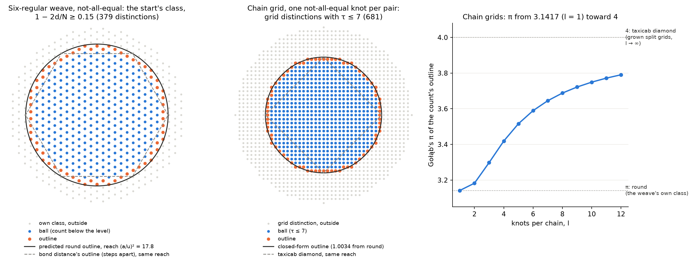

# Ball outlines under the disagreement count

Epic `COUNT-BALLS-20261118-001`, 18 November 2026, by Claude, on the coordinator's go-ahead. It takes backlog B195 (G1, a
challenge of A39) as the coordinator restated it: take a distinction, collect every distinction within a given disagreement count
of it, and ask how that ball grows, what its outline looks like, and whether the growth reads how many orders the base has,
without names or history. Goals G1 and G16; tests A97 and A39. **Referee pending.**

**Record.**
- Pre-registration: [preregistration.md](preregistration.md), frozen in commit `33de2e4cc` at 06:19:46 UTC. The run went from
  06:20 to 06:23 UTC (the census through the shared runner, `COUNT-BALLS-B1`, 136 s).
- Proofs and cited results: [proof.md](../../proofs/COUNT-BALLS-20261118-001A/COUNT-BALLS-20261118-001A-P001_count_balls/proof.md).
- Code: [weave.py, chain.py, outline.py, census.py, run.py, score.py, checks.py](../../experiments/COUNT-BALLS-20261118-001B/COUNT-BALLS-20261118-001B-E001_outlines/).
- Results: [results.json](../../artifacts/COUNT-BALLS-20261118-001B/COUNT-BALLS-20261118-001B-E001_outlines/results.json),
  the parts in `parts/`, post hoc readings in [posthoc.json](../../artifacts/COUNT-BALLS-20261118-001B/COUNT-BALLS-20261118-001B-E001_outlines/posthoc.json),
  the gates in [checks_output.json](../../experiments/COUNT-BALLS-20261118-001B/COUNT-BALLS-20261118-001B-E001_outlines/checks_output.json).
- Figure: [outlines.png](../../artifacts/COUNT-BALLS-20261118-001B/COUNT-BALLS-20261118-001B-E001_outlines/outlines.png).

## The answer

**In the owner's terms.**
- **Read by the disagreement count, a periodic law's balls are round.** On the six-regular weave under not-all-equal, the
  distinctions within a given count of a start fill a round outline: the reach is the same along every repeat to one part in ten
  thousand at sixty steps (computed exactly; the classical amplitude of Stephenson). Bond distance gives the same law a hexagon.
  So the record's verdict that periodic laws make polygons belongs to bond distance, not to periodic laws.
- **How round depends on how near the law is to its critical point.** On chain grids (a not-all-equal knot, or a chain of l of
  them, on each pair of the literature's square grid) the outline is smooth, with no corner and no flat side, and slightly off
  round: Gołąb's π is 3.1417 with one knot per pair, 3.18 with two, 3.30 with three, and tends to 4, the taxicab diamond, as the
  chains lengthen (closed form, classical). Grown split grids give the diamond exactly. The weave sits at its critical point and is
  exactly round there; that the outline rounds off at criticality is classical physics, and here it is the program's count.
- **The growth reads the dimension, not the number of orders.** How the outline grows against the ball reads the dimension of the
  meeting pattern whatever the count's scale: about ball^(1/2) on the weave and on the chain grid, so two. On the weave the count's
  own scale reads four instead (two divided by the law's exponent one half). A ladder of two orders and a comb of one order grow
  identically. And the profile of every start's growth, read without names, tells the number of orders on every base the program's
  cheapest growth reaches to twelve distinctions and on every base of up to six, but not from seven on: there it merges bases of
  two and three orders. The full table of counts, which also says which start's row is which, keeps the orders.
- **Taken literally, "states within r disagreements of a state" sees less.** It cannot tell a base from its translate by one of
  its own states, so it confuses one order with two at four distinctions. With the all-equal state marked it reads the orders
  exactly.
- **On parity bases the count sees nothing**, as known: every pair is at half.

| Base | How the count's ball grows | Its outline | Reads the number of orders? |
| --- | --- | --- | --- |
| Six-regular weave, not-all-equal (critical) | the start's class only, below half; size 0.193 u⁻⁴ with u = 1 − 2ρ/N, so exponential in τ (3^(4τ)) | round: same reach along every repeat to 1e-4 (computed); outline ~ ball^0.58 (fit; 1/2 predicted) | no orders defined; reads dimension 2 by outline against ball, 4 = d/η by the count's scale |
| Chain grid, l knots per pair (off critical) | τ-ball ~ τ² (effective 2.3 at τ ≤ 14) | smooth, strictly convex, off round by 1.0034 (l = 1), Gołąb π 3.1417 → 4 (closed form, checked to 5e-5 at l = 1) | reads dimension 2 (outline ~ ball^0.51) |
| Grown split grids and boxes of d orders | 2·L1: (2j)^d/d! | the cross-polytope (in two orders the taxicab diamond, π = 4) | yes on full boxes (k = λ = d), by construction |
| λ = 2 bases, NN's grids included | 2·L1 in the two orders | taxicab diamond clipped to the grown shape | the count is a two-way ruler, by the definition of λ |
| Cube Q_d | C(d, j) at count 2j | — | the nearest count is d |
| Ladder (2 orders) against comb (1 order) | 4 per count at every middle start | — | **no**: same growth, different orders (proved) |
| Grown split bases, every start's growth profile (no names) | — | — | yes to n = 12 (cheapest) and n = 6 (one split per step); **no** from n = 7 (3 of 1,651 groups, 227 of 58,985 at n = 8) |
| Parity bases | flat at N/2 | — | nothing (known) |



*Left: the weave's start class within 1 − 2d/N ≥ 0.15 (379 distinctions; blue inside, orange the outline) against the predicted
round outline and the hexagon of steps apart that bond distance gives. Middle: the chain grid (l = 1) within τ ≤ 7 against the
closed form and the taxicab diamond. Right: Gołąb's π of the chain grids' outlines. The literature's drawing is used only to show
the result; the counts come from the allowed states.*

### The weave: round, one class at a time

Exact pair counts on the endless weave come from honeycomb dimers (each knot has exactly one co-knotted pair with equal values),
with Kenyon's kernel evaluated exactly (rational plus √3/π) and 40-digit determinants; an independent Toeplitz formula for the
row agrees to 1e-61. Read out:
- **Amplitude.** √r·C along the row tends to a = 0.6322260 (fit 0.6322260 against the literature's 0.6322260804, Stephenson 1970,
  as the advisor derived it).
- **Even.** Along the repeats (4,1), (5,2) and (1,1) of the start's class, √r·C divided by the row's at the same separation is
  1.000023, 1.000050 and 1.000077 at r = 59.6, 56.2 and 60.6, down from 1.0001 to 1.0003 at half those separations, and ordered as
  the advisor's symmetry argument predicted. The hexagon of steps apart would give 0.931.
- **Exponent.** The row's log-slope between 57 and 60 is −0.49989 (η = 1/2).
- **The other two classes** have −a/2 (mean at r = 58, 59: −0.49999·a), with the advisor's ±1/(4r) split (0.008543 measured, 0.008548
  predicted). So below half the count's ball holds only the start's class (every scanned own-class pair positive, every other
  negative), and in τ the other classes' round outlines have a quarter of its reach.
- **Ball and outline.** The own-class ball at u = 0.17 and 0.15 has 235 and 379 members against 231.3 and 381.6 predicted. Outline
  against ball: log-log slope 0.577; ball against 1/u: 4.18 (four predicted). In τ the ball grows exponentially (ln size per unit τ
  4.19 at τ ≤ 1.6, 4 ln 3 = 4.39 predicted; post hoc).

### Chain grids: smooth, nearly round, tending to the diamond

Summing out the loose distinctions turns a chain of l knots into a pair weight with (w_eq − w_ne)/(w_eq + w_ne) = (−1/3)^l
(proved, and checked literally on 2 × 2 at l = 1, 2, 3 and on 3 × 3 open and wrapped at l = 1): the literature's Ising model at
high temperature. Exact pair counts by the Kac–Ward resolvent, two independent formulas agreeing to 1e-12:
- **l = 1**: the measured rate along (1,0), (1,1), (2,1), (3,1) at r ≈ 38–40 equals the closed form within 2e-5 to 5e-5
  (Richardson), and the ratio of diagonal to axis rate is 1.003399 against the closed form's 1.003400: nearly round, not round.
- **l = 2, 3**: the two formulas part beyond r = 9 (l = 2) and r = 6 (l = 3) in double precision; there the axis estimate is still
  above its limit (1.9823 at r = 9 against Onsager's exact 2(K* − K) = 1.9741, which the closed form equals), so C1 failed on the
  axis at l = 2 (pre-asymptotic; see the verdicts). The diagonal at l = 2 is within 1.3e-4.
- **τ-ball** (l = 1, grid distinctions within 22; post hoc within 40): it grows like τ^2.5 at τ ≤ 7 and τ^2.3 at τ 6 to 14,
  approaching two slowly because τ = m|x|/ln 3 + ½ log₃|x| + c; its outline against the ball has slope 0.51.
- With the gauge sign the raw count splits the grid distinctions into two classes by the parity of steps apart (proved; the
  frozen scan stored the sign-free values, see C4c).

### Orders: what the growth sees

- **Proved.** On split bases the count is twice the number of separating splits, so on full boxes it is twice the L1 distance
  and the growth exponent is the number of orders; on any base with λ = 2 it is twice the L1 distance of the two orders (this
  answers `NEVER-NEST-20261118-001#4`: NN's grids carry a two-way ruler by construction). But the ladder (k = λ = 2) and the comb
  (k = 1, λ = 5 at m = 10) have outlines of 4 at every count from every middle start: the growth reads how the distinctions
  spread, not how the splits cross.
- **Computed census** (frozen, `COUNT-BALLS-B1`). Every base the cheapest growth reaches from the line of three to n = 12, and
  every base reachable by steps adding at most one split to n = 8 (4, 12, 101, 1,656 and 59,675 classes at n = 4 to 8):

  | Reading (no names) | Tells k and λ apart | First failure |
  | --- | --- | --- |
  | (a) every start's sorted row of counts (the ball growth from every start) | every class through n = 6; cheapest growth through n = 12 | n = 7: 5 groups of 1,656 classes merge, 3 with different k (2 against 3); n = 8: 672 groups, 227 differ in k, 234 in λ |
  | (b) (a) with N | the same | the same |
  | (c) every state's sorted row of Hamming distances | — | n = 4: the star with three tips (k = 1) and its translate (k = 2); cheapest growth from n = 6 |

  The first merge of (a), on distinctions a to g with fourteen states each: the splits ce|abdfg, bce|adfg, bcde|afg, af|bcdeg,
  abcdf|eg, bcef|adg (k = λ = 3) against ad|bcefg, abd|cefg, ce|abdfg, bcde|afg, abdf|ceg, abcdf|eg (k = λ = 2), with identical
  multisets of rows. The full table (rows assigned to
  their starts) determines the base, so it determines the orders; what (a) loses is which start's growth sits next to which.

### The state side (the coordinator's literal words)

States within r disagreements of a state: on parity bases every state sees the code's weight enumerator; on a finite weave of 6 × 6
(263,640 states) the count within one disagreement ranges from 4 to 19 free flips by state and grows like a binomial in them; on
full boxes the states form one ring per order through the two all-equal states (on 7 × 7, 4 states at each multiple of 7 from the
all-zero state). Unrooted, the reading is blind to translating every state by one state (proved) and fails at four
distinctions; rooted at the all-equal state it determines k and λ (proved).

## Predictions and verdicts

| # | Prediction | Verdict | Reading |
| --- | --- | --- | --- |
| G | 28 gates | held | all pass, before the run |
| W1 | off-row own-class amplitude = row's within 1e-3 at r ≈ 60, not 0.931 | held | 1.000023, 1.000050, 1.000077 |
| W1b | the deviation shrinks from the middle to the largest separation | held | on all three repeats |
| W1c | dev·r² positive and ordered (4,1) < (5,2) < (1,1) | held | 0.082, 0.157, 0.282 |
| W2 | row log-slope −1/2 within 0.005 | held | −0.49989 |
| W3 | other-class mean −a/2 within 2e-3 | held | −0.49999·a |
| W3b | their split 1/(4·58) + 1/(4·59) within 20% | held | 0.008543 against 0.008548 |
| W4 | a = 0.6322260804 within 1e-3 | held | 0.6322260 (1.3e-7) |
| W5a | own class positive, others negative at every scanned pair | held | 1,764 pairs within 22 |
| W5b | ball at u = 0.17, 0.15 within 5% of 0.1932 u⁻⁴ | held | +1.6%, −0.7% |
| W6 | outline against ball slope in [0.40, 0.60] | held | 0.577 |
| W6b | ball against 1/u slope in [3.5, 4.5] | held | 4.18 |
| C1 | Richardson rates = closed form within 1e-3 (rays with ≥ 6 stable points) | **failed** | l = 1 all within 5e-5; l = 2 diagonal 1.3e-4; l = 2 axis 3.2e-3 (stable only to r = 9, pre-asymptotic) |
| C1b | plain rate at the largest stable separation within 3e-3 | **failed** | l = 1 within 5.4e-4; l = 2 axis 4.2e-3 |
| C1c | l = 1 diagonal/axis rate = 1.003400 within 1e-3 | held | 1.003399 |
| C4 | chain-grid outline against τ-ball slope in [0.40, 0.60] | held | 0.511 |
| C4b | τ-ball against τ slope in [1.6, 2.4] | **failed** | 2.51 at τ 2 to 7 (2.30 at τ 6 to 14 post hoc; the log term) |
| C4c | raw count positive exactly at even steps apart | **failed** | the frozen scan stored the correlation without the gauge sign (a code omission); with it, holds (post hoc), and the gate on the literal 3 × 3 checks the sign |
| G1 | (a) determines k and λ: cheapest n ≤ 12, one-split n ≤ 7 | **failed** | holds to n = 12 and n = 6; fails at n = 7 (3 groups) |
| G2 | (c) fails on k at n = 4 or 5 | held | at n = 4 |
| G3 | (a) determines k and λ at n = 8 | **failed** | 227 groups differ in k, 234 in λ |

14 of 20 held. The weave's eleven all held. The chain grid's failures are a pre-asymptotic axis at l = 2, where double precision
stops at r = 9 (C1, C1b), the slow logarithmic approach of the τ-ball's exponent (C4b), and a missing sign in the frozen scan (C4c);
none bears on the closed form, which equals Onsager's exact axis rate and matched every l = 1 ray to 5e-5. G1 and G3 failed in the
direction I had first expected and the advisors had not: the growth profile merges bases with different orders from seven
distinctions.

## What it means for A97 and A39

- **A97** (distance is the only form of information). On not-all-equal bases the count carries the information, and its balls
  have the shape one would want of distance: round on the critical weave and smooth on chain grids, with nothing hidden and nothing
  aperiodic. Their growth reads the meeting pattern's dimension through the outline. It does not read the number of orders, and
  its profile loses them from seven distinctions, while the full table keeps them: so the orders are information in the count's
  arrangement (which start's growth sits next to which), not in its growth. A97 stays under challenge.
- **A39** (space is spaced by bond distance). The outline depends on which reading spaces the law. Bond distance gives the weave
  the hexagon of steps apart, with rational π; the count gives it a round outline, π itself. The polygon verdict of
  `LOGIC-CIRCLE-20261107-001`, and "dimension from ball growth", rest on A39. Moved to **Under challenge**.
- **New A102** (default here): on an endless base the count is read in the maximal-entropy weighting, the limit of uniform
  weightings on finite pieces. On the weave a tilted weighting (another slope of the height) would make the outline an ellipse.

## Known results, and what this adds

Known, cited once: the triangular antiferromagnet's correlation and its amplitude (Stephenson 1964, 1970), the height mapping and
η = 1/2 (Blöte and Hilhorst 1982; Nienhuis, Hilhorst and Blöte 1984), honeycomb local statistics (Kenyon 1997); the Ising
correlation length in every direction (Onsager; Cheng and Wu 1967), its duality with the crystal's Wulff shape (Rottman and
Wortis 1981; Avron, van Beijeren, Schulman and Zia 1982; Holzer 1990; Akutsu and Akutsu 1990), Ornstein–Zernike decay with an
analytic strictly convex rate (Campanino, Ioffe and Velenik 2003); emergent rotation invariance at a critical point; lattice
dimension (Eppstein 2005; trees, Ovchinnikov); Gołąb's π.

What this adds: the reading. The program's own count, the one that carries every not-all-equal base, gives periodic laws round
or smooth outlines where its bond distance gives polygons, so the record's "no periodic law has a round circle" is a statement
about bond distance; the outline's growth against the ball reads the dimension without the count's scale (four on the weave by
the scale, two by the outline); the number of orders is not a growth quantity (ladder against comb, proved) and the growth profile
loses it from seven distinctions (computed); the state-side reading is blind to translation.

## Limitations

- The weave and chain grids are read on the endless base in the maximal-entropy weighting (A102); finite pieces differ (25% at
  L = 12, `DISTANCE-DIM-20261117-001`).
- Separations to about 60 on the weave and 40 on the chain grid (l = 1); at l = 2, 3 double precision limits the check to r ≤ 9
  and 6. The closed form is cited, and checked numerically only at l = 1 and the l = 2 diagonal.
- "Round" is read in the literature's drawing of the weave. The amplitude ratio is name-free (counts only), but the separations it
  compares are the drawing's Euclidean lengths, so the statement is that the count's outline is the drawing's circle.
- The outline exponents are fits over a short range (u = 0.30 to 0.15; τ = 2 to 7), not limits.
- The census covers bases grown from the line of three by betweenness knots: the cheapest growth to n = 12 and steps adding at most
  one split to n = 8.

## Reproduce

```sh
d=experiments/COUNT-BALLS-20261118-001B/COUNT-BALLS-20261118-001B-E001_outlines
.venv/bin/python -B $d/checks.py
for p in weave_rays weave_scan chain_rays chain_scan outline_cf census state_side; do .venv/bin/python -B $d/run.py --part $p; done
.venv/bin/python -B $d/run.py --score
.venv/bin/python -B $d/posthoc.py     # labelled post hoc readings
.venv/bin/python -B $d/figure.py
```

## Advisor

`claude -p --model claude-fable-5-2` was asked once before the freeze ([question](advisor/question_1.md)). The first call, without
`--tools ""`, fell back to another model, which ran its own scripts ([answer](advisor/answer_1_fallback_model.md)); the second was
answered by claude-fable-5-2 ([answer](advisor/answer_1_fable.md), checked in `modelUsage`). Used for analysis: the row's exact
Toeplitz form and the amplitude (both checked independently in the run), the 1/r and 1/r² corrections behind W1b, W1c and W3b, the
correction to "equal r" in W3, the outline-against-ball exponent (W6, C4), the translation blindness of the state side (G2) and its
rooted repair (proof S4), the loose identity gate, and the Richardson estimator. Not taken: a reading of "two neighbours agree"
variables (XOR values; the guardrails forbid deriving a distance from them). Its census expectation for (a) was wrong at n = 7.
Not consulted after the read-out.

## Referee

Pending. To be run by the coordinator's background referee thread.

## Position

| Scope | Verdict | Why |
| --- | --- | --- |
| This attempt: count balls, outlines and orders | **Status:** Successful (referee pending) | Round on the weave (11/11 weave predictions held), smooth and nearly round on chain grids with a closed form, the diamond on split grids; growth reads the dimension, not the orders; profile loses orders from n = 7; 14 of 20 held |
| Local direction: the count as the program's ruler | Promising | It carries the information, gives smooth outlines and reads dimension through the outline; what it lacks is the orders, held only in the arrangement of its rows |
| Broader exploration: roundness from logic | Known alternatives | Rotation invariance at criticality and Wulff shapes are classical; the program's step is the reading under its own count |
| Long-term goal: G1 and G16 | G1 capability gained; G16 obstruction learned | G1: round outlines from a periodic local law, read from its states. G16: the number of orders is not a growth quantity of the count |

**Next step:** Research directions. None is selected; the first starts on the coordinator's go-ahead.

| # | Direction | Payoff | Concreteness | First step → stop when | Status |
| --- | --- | --- | --- | --- | --- |
| 1 | What the rows' arrangement holds: on grown split bases, which reading between the sorted profile and the full table (each start's growth together with its nearest starts' growth, say) recovers the orders, and is there a local one? | 2/3 | 3/3 | census at n = 7, 8 with readings of growing reach → stop at the smallest reach that separates every class | Alternative |
| 2 | Criticality as the price of roundness: among knot laws on the weave and chain grids, is the count's outline round exactly at the critical laws, and does a law off its critical point ever give a round one? | 2/3 | 2/3 | the anisotropy of the count's rate on WEAVE-MIX's gapped pair and on decorated chain grids → stop at a round off-critical law or a proof that criticality is needed | Alternative |
| 3 | The tilted weave: under a weighting of another slope (A102's challenge) the outline should be an ellipse; can a uniform local rule select the round one? | 1/3 | 3/3 | exact kernels at non-zero slope → stop at the ellipse's ratio as a function of slope | Alternative |
| 4 | A distance that reads both parity and not-all-equal bases (bond distance is flat on betweenness grids, the count flat on parity): the least set's size plus its correlation, say | 3/3 | 1/3 | define one candidate and test it on the cubic parity system and a split grid → stop at one that reads both or an obstruction | Sub-goal B200 |
| 5 | The chain grid at l = 2, 3 in high precision, to settle C1 | 1/3 | 3/3 | the 1D residue form of the Kac–Ward resolvent in 50 digits → stop at the rate to 1e-4 | Alternative |

**Corrections:** none. No published claim was found false: the record's polygon verdict was stated for bond distance, and the
Intuitions guide says so; this study adds that the count gives the same periodic laws smooth outlines.

**Goals:** G1 checkpoint (capability gained: round outlines from a periodic local law under the information-carrying count) and
G16 checkpoint (obstruction learned: the number of orders is not read by the count's growth, and its unnamed growth profile loses it
from seven distinctions); no goal changed.

**Assumptions:** A39 to Under challenge (the outline depends on the reading that spaces the law); A97 gains this study; new A102
(the maximal-entropy weighting on endless bases).

## The final report as sent (18 November 2026)

**Outcome:** read by the disagreement count, a periodic law's balls come out round. On the six-regular weave, the start's own
class fills a round outline. Measured along every repeat, it reaches equally far to one part in ten thousand at sixty steps. Bond
distance gives the same law a hexagon, so the record's "periodic laws make polygons" belongs to bond distance. Chain grids give
smooth outlines just off round: Gołąb's π is 3.1417 with one knot per pair and tends to 4 as the chains lengthen. Grown split
grids give the taxicab diamond. How the outline grows against the ball reads the dimension of the meeting pattern (two). It does
not read the number of orders: a ladder of two orders and a comb of one grow identically (proved). Without names, every start's
growth stops telling two orders from three at seven distinctions, though the full table of counts still does. Taken literally,
"states within r disagreements of a state" sees even less, because it can't tell a base from a copy shifted by one of its own
states. 14 of 20 frozen predictions held. The weave's 11 all held. The 6 misses are pre-asymptotic or a missing sign in my code,
plus the census failing earlier than predicted. The epic is closed with the referee pending.

The position table, the next-step line and the five directions as in Position above (direction 4 filed as sub-goal B200).

**Corrections:** none. The polygon verdict was already stated for bond distance.
**Goals:** G1 checkpoint (capability gained); G16 checkpoint (obstruction learned); no goal changed.
**Assumptions:** A39 moved to Under challenge, because the outline depends on which reading spaces the law. A97 gains this study.
A new entry, A102, records that endless bases are read in the maximal-entropy weighting.
