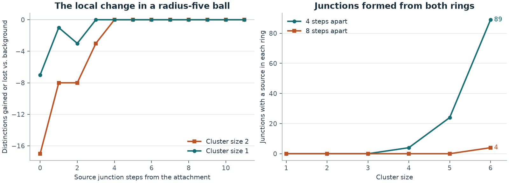

# A self-feeding ring in a background of dimension two

A five-knot ring keeps its identity and its own growth when attached to this background. Two copies produce junctions together sooner and at a larger long-run rate when attached four steps apart than when attached eight steps apart. Their original attachment knots stay where they are. An attachment changes nearby bond distances even when the ring’s return is cut. The least reach of a change at an original shared distinction is identical beside the ring and far from it.

The definitions, predictions and exact source supports were committed as `0e0eae1c2` before measuring any of the ten starts. This was one designed sample. Each case and size is reported separately. No weighting over all starts is assumed. A within-offset average gives each of the original shared path distinctions at that offset equal weight. A share of births at a size gives each junction of that size one vote. Independent referee review is pending. The integrated replay command is `.venv/bin/python -B experiments/EDDY-WORLD-20261119-001/EDDY-WORLD-20261119-001-E001_world/verify_findings.py`. [Frozen definitions](definitions.md) · [Pre-registration and earlier studies](preregistration.md)

## What grows

The background is a path of 17 junctions. Their map of joins has two pieces without cycles, each with two endless chains. The cluster-identification and tree-dimension theorems give 17+2t new junctions at round t and (t+1)(t+17) accumulated junctions. The fixed dimension two describes that cumulative count. We measured balls in bond distance separately. The attached five-junction ring has zero, one or two leftover distinctions. Each two-copy start uses two of the one-leftover rings. At an attachment, one actual knot belongs to the ring and the path. We supplied the loose distinctions needed to fund all the first joins while preserving the stated leftovers. The largest joined knot has eight places.

The decorated-ring theorem gives isolated growth factors 1.134724 and 1.262775 per additional unit of cluster size; the bare ring gives exactly five junctions at each size. The full single attachments have growth factors 1.856675, 1.940108 and 2.024649 for zero, one and two leftovers. Their map has one cycle with four endless chains attached. The full double attachments have three independent cycles. Cutting the return of the one-leftover ring while keeping the loose count of *every* junction fixed gives a tree with cumulative dimension three. The initial dimension-two background survives as an exact part inside every joined start. The full joined growth has its own fate. The proof checks the hypotheses beyond the five-place isolated-ring catalogue. [All-size derivations and rate certificates](theory_fate.md) · [Source qualification](growth_checks.md)

## The four readings

**1. Persistence.** Give the reader all the junctions and the distinctions they currently hold, renamed from scratch. It can find the growing end from distinctions held only once. In these all-live starts the largest number of junction steps to that end picks out exactly the original knots. Their shared distinctions, the first-join demands and the leftover counts identify each five-ring as bare or self-feeding. Count new junctions confined to each inferred ring. Their counts at every size equal its isolated counts by restriction of the unrolled map, and the same holds for the background. This distinguishes growth at the ring from the mere survival of its original five knots. Two interchangeable copies are an unordered pair. The reader uses the present incidence, which physically retains earlier knots; this result does not require their names, order of addition or a supplied origin.

Erasing all but the growing end and the preceding layer is a stronger test. On the 150 positive-age cuts, a lookup compiled from the finite sample can recover the unordered growing members of each *decorated* ring wherever it occurs. All same-sized potential confusions and membership-changing symmetries were checked. At the symmetric eight-step placement the two complete copies can exchange names. On 31 bare-ring controls, a symmetry exchanges current and preceding junctions. The direct local rule did not locate a decorated ring on every cut without a catalogue. An unrestricted recognizer on this erased input stays open. [Recognition tests](recognition.md)

**2. Bending.** At every stage, for each of the 16 original path distinctions, the entire ball through bond radius five was counted, as was its intersection with the same 16 distinctions. At a shared distinction incident to the attachment, the radius-five ball on B contains 13 distinctions at size one and 23 at size two. The corresponding attached ball has six at both sizes. Restricted to the original path marks, the count falls from five to two in both comparisons. At size one the radius-five differences at offsets 0, 1, 2 and ≥3 are −7, −1, −3 and 0. The near effect has finite measured reach and its falloff at these offsets is nonmonotone. At every shared positive age the radius-five differences for offsets 0, 1, 2, 3 and ≥4 are −17, −8, −8, −3 and 0 in the single-attachment comparison. The radius-three differences next to the seam are already −6. These counts are identical for the bare, one-leftover, two-leftover and funded cut attachments over their common size range. The registered rate ordering gives **no effect on these path-anchor balls**. Individual marks *on* the ring can see a changed local leftover. At size two the radius-five balls of c3–c4 in J1 and J2 contain 9 and 12 distinctions; at c1–c2 the two counts are both 12. That gives a location-dependent response with no single scaling law.

The source has an exact formula for every original path pair. A pair spanning the entire attachment gains eight units of bond distance even when its two marks are both far away. Of the 120 original path pairs, 62 lengthen at size one and at size two when one ring is attached; at size one some gain eight, while the largest gain at size two is six. Long pair values on larger stages can be censored even where ball membership is exact. A change in the size of a local ball and a uniform contraction or stretching of all distant pairs therefore have different answers. [Exact bond measurements](bending.md) · [Source formula](source_bonds.md)

**3. Spread of a change.** At size one, forcing any original shared path or ring distinction to change allows two other distinctions to change, both within one co-knotted-pair step. From size two onward it takes exactly three other changes and every smallest response reaches exactly two such steps. For example, change the two original path meetings b3–b4 and b4–b5, and the two distinctions b3 and b5 spent on their common child. All four involved junctions change in two places, so their parity is preserved. Each original shared distinction belongs to a permanent four-distinction allowed change after the first layer. This proves the size and reach at every later size for every frozen start. The same result at size two and later survives holding all other loose distinctions fixed. Under that restriction at the source, original path marks cannot flip and original ring marks need four other changes. The local number of equally short responses *does* change. A path distinction incident to the attachment has four choices at positive ages, compared with two on B. The bare and cut controls give the same increase.

All 55,581 current loose distinction observations in the 160 stages have a one-other-distinction response at their own holder, one physical distinction step. For a fixed flippable distinction in general complete open growth, the least number of additional flips can increase by at most two per round. The least and greatest physical reach among shortest responses can each increase by at most one step; a downwards change in these radii can be arbitrarily large outside this sample. These are comparisons between allowed states at each cluster size. The experiment generated no signal travelling from one junction to another. [Spread evidence](spread.md) · [General bounds and controls](world_readings.md)

**4. Interaction.** Each ring-only part in the two-copy starts keeps the isolated factor 1.134724. The combined growth depends on the placement. The first junctions using an exclusive original knot from both rings have size 4 for the four-step placement and size 6 for the eight-step placement. There are exactly four at the first such size in each case. At size six the two starts have, respectively, 89 such junctions among 520 and four among 435. Giving every junction of size m one vote within the specified start, the fraction that uses both rings tends to one as m grows in both placements. Exact rational bounds for the full growth factors are [2.724, 2.725] and [2.380, 2.381]. These are all-size exponential factors from the counting equations.

The original attachments remain four or eight junction steps apart. The current ring-only parts, requiring a ring-exclusive source on each side, are d+2 junction steps apart at size one and d+2t at size t+1≥2. They are 14 or 18 steps apart at size six even as shared growth forms between them. The least bond distance between the two sets of original ring-exclusive distinctions falls from 31 to 19 in T4 and from 39 to 27 in T8 when size one grows to size two. Restrict to distinctions *already shared* in the source and the same transitions are 31 to 27 and 39 to 35. All three readings, including the two fixed c1–c2 marks, keep their size-two values at size three. The next size exceeded the registered width of the exact calculation. Later sizes have certified bounds rather than full minima. Every old allowed state extends to the next stage, so every old minimal bond is still a minimal bond on its original support. A bond distance between fixed old distinctions can only stay the same or decrease. Once finite, it is a positive integer and eventually stabilizes, without a known age for its final decrease. Fixed original shared ring distinctions, current ring-only junctions and a birth drawing on both rings give three different readings. [Junction-step proof](steps.md) · [Bond distances between rings](ring_distance_dp.md)

## Coverage and predictions

Every complete lawful round up to each frozen cap was exported. The cluster-size cap was 33, with at most 2,048 accumulated junctions and 8,192 distinctions per full stage. The totals below are for the last fully built stage. Counts from the map were independently compared against all 160 literal stages. There were 378 comparisons of whole or restricted counts and 30 independent relabelings. All 160 stages have complete radii one through five for the chosen marks, giving 15,180 exact ball counts. The integrated replay checks the two rational growth-rate brackets, all 840 marked source path pairs and all 18 reported two-ring bond witnesses. Direct state-change checks cover 162 original-mark observations at size one and 1,737 at positive ages. The mathematical conclusions above have separate all-size arguments.

| Start | Last cluster size | Last round | Accumulated junctions | Distinctions |
| --- | ---: | ---: | ---: | ---: |
| Background | 33 | 32 | 1,617 | 3,250 |
| Bare ring | 33 | 32 | 165 | 335 |
| One-leftover ring | 30 | 29 | 1,720 | 7,510 |
| Two-leftover ring | 18 | 17 | 1,378 | 6,739 |
| Attached bare ring | 8 | 7 | 1,394 | 7,609 |
| Attached one-leftover ring | 7 | 6 | 953 | 5,184 |
| Attached two-leftover ring | 7 | 6 | 1,147 | 6,787 |
| Two rings, four steps | 6 | 5 | 1,025 | 5,926 |
| Two rings, eight steps | 6 | 5 | 912 | 4,814 |
| Funded cut control | 12 | 11 | 2,038 | 7,593 |

P1 held on full incidence and for the exact ring-only count. P2's suggested loss of decorated-ring identity on the erased growing end did not appear within the finite catalogue, and a bare control did lose its phase. P3 held. P4's near/far prediction held on the registered balls; its larger-effect prediction for the faster eddy failed. P5's state independence and uniform ring bound held; its prediction that a path mark would require a longer unrestricted response failed. P6 and P7 held under their specified readings. The two-source distance computation and the movement control below are additional, declared follow-ups on the frozen marks. Earlier source theorems stand. A97, A104, A109 and A110 retain their stated scopes.

## First movement test

There is already room for a travelling state pattern. Take the four-distinction change on three consecutive background knots and their common child in J1. Its neighbouring copy shares one distinction. Switching the six distinctions in their difference carries one allowed state to the next. Two such local switches give successive junction-step readings (6,8), (7,7), (8,6) to the two original ends. Both switches preserve every parity equation at every positive stage. We checked the explicit supports through size seven. This is an after-the-fact test of available states; the growth rule never chooses one of these switches. [Construction](../../experiments/EDDY-WORLD-20261119-001/EDDY-WORLD-20261119-001-E001_world/adjacent_changes.py) · [Three states and their literal changes](../../artifacts/EDDY-WORLD-20261119-001/EDDY-WORLD-20261119-001-E001_world/adjacent_changes.json)

The ring behaves like a fixed object in one respect: it remains identifiable and keeps doing the same thing locally, while its surroundings and another ring affect what grows together. Its position relative to the original background stays fixed. The first experiment for motion would give a localized pattern a parity-preserving update that can read only what meets it, then test whether the same pattern appears one step farther along twice without choosing its destinations. Two fixed, distinguishable landmarks would score the shift. To call it the eddy moving, its self-feeding activity would have to leave the first attachment and reappear at its neighbour. A round here records the size of a configuration. No clock selects or advances a state.
