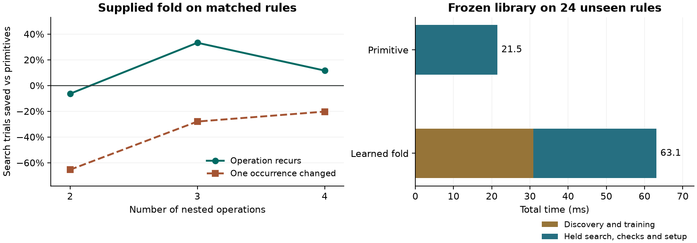

# A fold supplied for free and a fold learned from programs

On November 15, 2026, a supplied fold reduced direct search on recurring rules at depths three and four. The benefit was largest at depth three and disappeared in a nine-essential-input control. That qualified it for the discovery experiment specified before the run. A second learner then discovered a different fragment. On 24 fresh rules it took **63.139 ms** including acquisition, against **21.515 ms** for primitive search. There was no break-even at any prefix of the 24-rule stream. Its remaining gap was **41.625 ms**. Every method returned a correct program on every input. [Supplied-fold results](../FOLD-DEPTH-20261115-001/scaling.md) · [Frozen-library results](../../artifacts/FOLD-DISCOVERY-20261115-001/FOLD-DISCOVERY-20261115-001-E001_learned_library/result.json)



## Which operation the learner found

We gave ordinary primitive search 24 training tasks at four, six and eight inputs. Its 24 verified programs contained 96 adjacent pairs of operations. Replacing the three external operands of a pair with anonymous inputs and grouping equal truth functions under permutation produced eight candidates. The learner ranked them by the number of distinct programs in which they occurred, then by total occurrences. Seven eligible candidates were discarded. All eight candidate implementations were verified on all eight inputs, including the alternatives that were discarded. The learner received no planted locations, training formulas or prior fold.

| Fragment, up to operand order | Training programs containing it | Total occurrences |
| --- | ---: | ---: |
| Learned, a AND (b XOR c) | **19 of 24** | 25 |
| Earlier fold, (a AND b) XOR c | 18 of 24 | **33** |

The earlier fold occurred more often in total, while the selected one appeared in one more training program. They are distinct Boolean functions even under input renaming. For example, on (a,b,c) = (0,0,1) the first produces zero and the second produces one. Across all eight inputs the learned rule is true twice and the earlier one four times. One actual training template was d AND F(a,b,c). Its expanded program contains the intended inner (a AND b) XOR c. Taking the outer two operations gives d AND (u XOR v), with u standing for a AND b and v for c. The same program therefore supplies evidence for two different candidate boundaries. The training distribution was deliberately favorable to recurring fragments: 18 of 24 specifications contained the earlier fold. The extraction rule was frozen before training. [All eight candidates and the ranking](../../artifacts/FOLD-DISCOVERY-20261115-001/FOLD-DISCOVERY-20261115-001-E001_learned_library/candidates.json) · [Training tasks](training_tasks.py)

## Paid transfer on unseen structures

A training task uses an even number of essential inputs. The held functions use five, seven and nine essential inputs at depths two, three and four, with four matched pairs at each depth. The reserved compositions shared no full structure with the first experiment under input renaming and associative regrouping. A solver receives a complete target truth table. It gets no source expression, hidden argument grouping or indication of which tasks contain a particular fold. Each library arm generates possible placements directly from its frozen three-input truth table. The candidate ordering is invariant under renaming that entry's formal input ports. [Preselected design](preregistration.md) · [Data and source commitments](../../artifacts/FOLD-DISCOVERY-20261115-001/FOLD-DISCOVERY-20261115-001-E001_learned_library/design.json)

| Warm-cache method, 24 held rules | Placement tests | Rejected placement tests | Discovery | Held work through verified returns | Total |
| --- | ---: | ---: | ---: | ---: | ---: |
| Cached primitives | 1,279 | 1,191 | 0 | 21.515 ms | 21.515 ms |
| Discovered fold | 4,013 | 3,939 | 30.921 ms | 32.218 ms | 63.139 ms |
| Same discovered operation inlined | 4,013 | 3,939 | 30.921 ms | 32.889 ms | 63.810 ms |
| Original fold supplied for free | 1,543 | 1,474 | 0 | 24.783 ms | 24.783 ms |

The 30.921 ms discovery bill included **29.246 ms** to initialize the training solver, solve and check the 24 rules and emit their programs, **1.472 ms** to enumerate, rank and certify the eight candidate classes, and **0.203 ms** to certify and export the selected entry. Primitive training itself used 2,091 placement tests, including 2,014 rejections, and verified 2,688 training rule–input pairs. The original fold's historical acquisition was charged zero in the supplied arm. The learned arm never received that fold. [Acquisition receipt](../../artifacts/FOLD-DISCOVERY-20261115-001/FOLD-DISCOVERY-20261115-001-E001_learned_library/gate-freeze.json)

The learned arm used its selected operation 19 times across the 24 correct held programs. The separately supplied original fold was used 60 times. All 5,376 held rule–input pairs were correct in each arm and repeat. No whole-program run failed in the 24 training solves or the 960 measured held solves. Rejections still cost time. In the learned arm, search on the 24 held tasks took about 16.67 ms and verification about 1.98 ms, versus 10.79 and 1.96 ms with primitives. Starting the process-level solver and loading the entry also mattered on this small workload. Median startup was 10.98 ms with the learned entry, versus 6.31 ms with primitives. Medians of individual phases need not sum exactly to the median total.

| Held depth | Recurring rules, primitive / learned / supplied trials | Broken rules, primitive / learned / supplied trials |
| ---: | ---: | ---: |
| 2 | 64 / 220 / 58 | 86 / 260 / 99 |
| 3 | 168 / 458 / 237 | 214 / 500 / 398 |
| 4 | 389 / 1,257 / 295 | 358 / 1,318 / 456 |

Each table entry totals four distinct functions under the primary within-arity cache policy. Resetting caches on every held rule increased the learned total to 74.409 ms against 29.772 ms for primitives, a remaining gap of 44.637 ms. All elapsed figures are medians of five sequential runs on this host. Warm means previously examined subproblems can persist between different rules of the same arity. Both sides start deployment with empty search caches. Only the frozen entry transfers from training. [Raw held streams](../../artifacts/FOLD-DISCOVERY-20261115-001/FOLD-DISCOVERY-20261115-001-E001_learned_library/results.jsonl)

The experiment found a case where access to an operation changes the amount of search on larger compositions. A library that inlines the same knowledge obtains the same semantic search. The frequency-based learner did not make the complete workload cheaper, even if its training bill is set aside. This evidence is bounded by the synthetic distributions, truth-table access and the one-entry, two-operation library.

An independent audit re-derived the fragment ranking and cofactor trials, searched the training programs for complete reserved structures, and replayed all 960 held program returns on 215,040 individual inputs. It verified all cumulative cost comparisons. Named and inlined versions had the same NAND dependencies and gate counts; some independent operations were emitted in a different order. [Independent audit](../../artifacts/FOLD-DISCOVERY-20261115-001/FOLD-DISCOVERY-20261115-001-E001_learned_library/audit.json)

## Reproduce

Recompute the paid comparison from the stored receipts:

```sh
python3 -B research/FOLD-DISCOVERY-20261115-001/assess.py
python3 -B research/FOLD-DISCOVERY-20261115-001/audit.py --audit
python3 -B research/FOLD-DEPTH-20261115-001/assess.py
```

To acquire and fit from scratch, use a fresh output directory. The bind helper reproduces the preselected tables. The separate training process opens only the training split. The shared runner opens held tables only after the frozen checkpoint exists.

```sh
e=experiments/FOLD-DISCOVERY-20261115-001/FOLD-DISCOVERY-20261115-001-E001_learned_library
out=$(mktemp -d)
python3 -B "$e/bind.py" "$out"
python3 -B "$e/train.py" "$out"
python3 -B scripts/longrun.py launch "$e/job.py" --out "$out" --unit fold-discovery-replay --workers 1 --case-timeout 120 --case-mem 1G --mem-max 3G --max-cases-per-worker 1 --param "data_dir=$out" --prepare-only
python3 -B scripts/longrun.py run --out "$out" --foreground
python3 -B research/FOLD-DISCOVERY-20261115-001/assess.py "$out"
```
