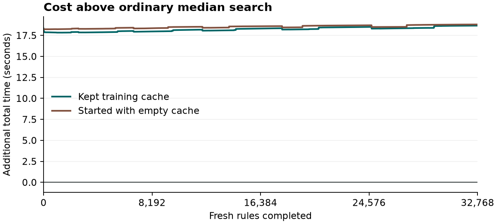

# Did learning when to try a fold repay its cost?

On November 15, 2026, a second learner finished 32,768 preselected fresh six-input Boolean rules. **It never broke even.** Ordinary median search took 12.403 seconds. The learner that could try the fold took 31.065 seconds including acquisition and training, even when it kept its paid training cache. At the end its additional cost was 18.662 seconds. The closest it came was 17.827 seconds behind at rule 1,367. None of the three paired timing repeats reached break-even at any prefix. [Measured results](../../artifacts/FOLD-GATE-20261115-001/FOLD-GATE-20261115-001-E001_gated_stream/result.json)

| Method | Runs | Upfront acquisition and training | Search through verified returns | Total wall time |
| --- | ---: | ---: | ---: | ---: |
| Ordinary lower median, empty cache | 3 | 0 | 12.403 s | 12.403 s |
| Learned decision, retained training cache | 3 | 18.237 s | 12.828 s | 31.065 s |
| Learned decision, empty cache | 3 | 18.237 s | 12.963 s | 31.200 s |
| Always try one fold, empty cache | 1 | 11.058 s | 13.545 s | 24.602 s |
| Ordinary median, granted its training cache | 1 | 0 charged for that cache | 12.340 s | 12.340 s |
| Ordinary median, its own descending counterexamples | 1 | 0 | 12.947 s | 12.947 s |

Three-run entries use the median observed cumulative time at each prefix. Upfront costs and totals are rounded independently. Terminal additional cost in the three individual warm-cache comparisons was 18.672, 18.679 and 18.546 seconds. The single-run controls have lower timing precision. The last row uses the earlier adaptive checking protocol and receives different teaching observations. [Per-run timings and receipts](../../artifacts/FOLD-GATE-20261115-001/FOLD-GATE-20261115-001-E001_gated_stream/results.jsonl)



## What the decision learned

The original fold computes `(a AND b) XOR c` with a saved seven-NAND program. Training the decision used 1,024 distinct six-input rules, including 64 warm-up rules. We ran each choice on the same rule three times. From the last 960 rules, the learner tested thresholds on five features of the initial eight labeled examples. These included the number of positive labels, how closely an input predicted the output, and how often changing inputs from zero to one turned a positive answer negative. None of the 66 eligible thresholds saved training CPU time. The frozen policy kept ordinary median search for every possible prefix. A threshold had to reduce paired training CPU time, with at least four training rules on each side. [Gate fit and training cost](../../artifacts/FOLD-GATE-20261115-001/FOLD-GATE-20261115-001-E001_gated_stream/gate.json) · [Paired training records](../../artifacts/FOLD-GATE-20261115-001/FOLD-GATE-20261115-001-E001_gated_stream/training.json.gz)

On 125 of the 960 fitting rules the fold route measured cheaper. Even selecting the cheaper route after seeing both timings on every training rule would have saved only 2.206 ms in aggregate against the 572.118 ms paired median-search CPU baseline. Always trying it cost 645.810 ms on those records. The held policy made zero fold attempts. Ordinary and gated median consequently made the same 145,959 proposals and 138,098 distinct-within-task terminal checks. The retained training cache saved 1,697 new physical program builds on the held stream, from 43,441 to 41,744.

The unconditional control shows that the choice sometimes matters for an individual rule. It got 119 first proposals right against 100 for ordinary median. Three of those were the same successes. The fold succeeded immediately on 116 rules where median needed more examples, and median succeeded immediately on 97 where the fold needed more. Across the stream, the fold control made 138,194 terminal checks, 96 more than median. Of the 32,768 targets, 16,772 admitted an implementation using the saved fold somewhere. Membership in that set alone does not identify which first proposal will answer the whole rule.

Across the held stream, 47 of the 256 observed initial answer patterns had two targets with opposite first-proposal winners. For example, rules 3,228 and 4,262 had identical answers on the first eight inputs. The fold proposal was immediately correct on rule 3,228, and median was immediately correct on rule 4,262. The 11th observation, public input 28, was the first distinguishing them, with respective answers one and zero. For those pairs any policy restricted to the eight examples must make the same first choice on both. This was a post-evaluation diagnostic about first proposals. It does not establish an impossibility for average savings. [Paired results and example](../../artifacts/FOLD-GATE-20261115-001/FOLD-GATE-20261115-001-E001_gated_stream/result.json)

## What was compared

Training used 150 rule structures. The held stream used 487 other structures up to any renaming of the six input variables. All 32,768 held truth tables were distinct and each depended on every input. Many held tasks were different labelings of the same structure. The referee bound both target orders before training, and the checkpoint was frozen before the held runner opened the targets. [Design receipt](../../artifacts/FOLD-GATE-20261115-001/FOLD-GATE-20261115-001-E001_gated_stream/design.json) · [Frozen gate and caches](../../artifacts/FOLD-GATE-20261115-001/FOLD-GATE-20261115-001-E001_gated_stream/gate-freeze.json)

Both primary methods received the same eight initial labels and the same 56 later observations in fixed batches. On each later row the checker reports whether a fixed public prediction agrees. These observations were processed and charged even for a program that succeeded early. At each stage the ordinary method submitted the lower median truth function among functions consistent with the visible labels. Choosing the fold would change only the first proposal to the median among consistent functions expressible with that single saved operation. A rejected candidate received no private counterexample. Both methods could remember a repeated unsuccessful proposal within that task.

Public indices cover possible truth functions. Each method built and verified physical NAND programs only as needed. On a cache miss it evaluated the actual gates over all 64 inputs. On later uses it could check the already-certified output column. A program returned successfully only if all 64 values equaled the target. The final program records store the actual gate operands and output wires. Each arm returned exact answers on all 2,097,152 held rule–input pairs. [Shared search](../../experiments/FOLD-GATE-20261115-001/FOLD-GATE-20261115-001-E001_gated_stream/search.py) · [Checker](../../experiments/FOLD-GATE-20261115-001/FOLD-GATE-20261115-001-E001_gated_stream/lesson.py)

The 18.237 seconds came from 11.058 seconds for original source acquisition and certification and 7.179 seconds for the paired training passes, fitting, and preserving the reusable cache. The upfront 18.237 seconds alone exceeded the 12.403 seconds ordinary median needed to finish every held task. Even a hypothetical zero-cost deployment could not have repaid that training within this stream. Deployment counts cache loading, indexing, searching, physical materialization, checking and constructing each executable return. Fixture production, scientific trace writing and the independent replay are outside both deployment bills. The first verified training pair took 0.762 seconds from training start. The sequential held runner finished all twelve method/repeat runs in 161 seconds with peak measured worker RSS of about 202 MiB. Elapsed time is specific to this machine and implementation. The fitted decision, work counters and full-input correctness are separate deterministic records. [Original acquisition ledger](../../artifacts/FOLD-REUSE-20261115-001/FOLD-REUSE-20261115-001-E001_second_learner/source_cost.json) · [Shared-runner receipt](../../artifacts/FOLD-GATE-20261115-001/FOLD-GATE-20261115-001-E001_gated_stream/state.json)

The measured result answers the payback question for one fold, one eight-example threshold family and this bounded rule distribution. It leaves open whether different evidence can reliably identify the handful of first proposals where a fold helps. The experiment supplies no evidence for a speedup in real AI research.

## Reproduce the comparison

Run the assessor from the repository root against the saved receipts. It recomputes cumulative totals at all 32,768 prefixes, the frozen policy's choices, and the counts for the unconditional control.

```sh
python3 -B research/FOLD-GATE-20261115-001/assess.py
```

The independent audit passed. It reconstructed the two splits, gate fit, candidate choices for each of the six protocols, and all twelve timing ledgers. A separate interpreter evaluated 35,220 distinct saved circuits, including training circuits, on all 64 assignments apiece. For failed held proposals, the records permit semantic and cost replay; only returned held circuits were exported. [Independent audit receipt](../../artifacts/FOLD-GATE-20261115-001/FOLD-GATE-20261115-001-E001_gated_stream/audit.json)

```sh
python3 -B research/FOLD-GATE-20261115-001/audit.py
```

The design and gate receipts bind the training/testing partitions, the previous fold and compiler, and the exact study sources. Repeating training on another machine produces new measured CPU costs and may fit a different decision. [Preregistered design and sources](preregistration.md) · [Assessment code](assess.py)
