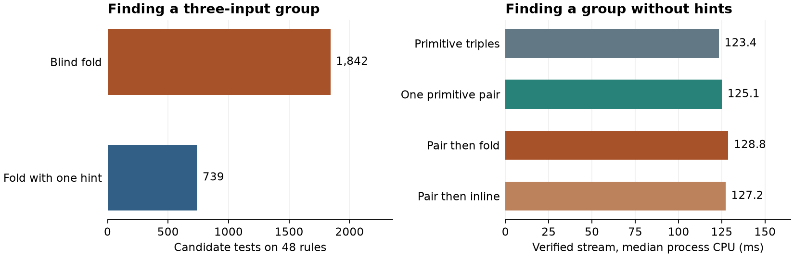

# Finding a fold from a pair of current answers

The blind solver found all four usable copies of the supplied fold on each of 24 recurring rules and three on each of 24 matched edits. It could join independently computed answers. Finding and returning those programs used **128.777 ms of process CPU**, against **123.416 ms** for cached primitives that can group three inputs. The fold used more CPU in every one of eight paired runs. The [prespecified test](preregistration.md) therefore stopped before paid selection among the eight saved fragments or an increase in depth.

## The controlled comparison

The [preceding experiment](../FOLD-PLACEMENT-20261115-001/placement.md) gave some solvers just the identities of one valid group of three inputs. This avoided 1,103 candidate placements for primitive, named and inlined repeated grouping. The blind fold missed its speed gate. The present solver must derive all of its groups from a nine-input truth table. If a pair admits a single AND, OR or XOR, it can use the pair's computed answer as one input for the next step. The guided solver checks whether a third current operand completes the supplied fold. When no third works, it can still take the ordinary pair. The no-library pair solver takes that same atomic action immediately.

All arms had the same public stream and the same opportunities to cache successful and unsuccessful work. The candidates differ in which groups they test. The six-NAND fold was available for free. Each rule was fully specified. The 48 unhinted targets use fresh input names and a fresh order across the same 24 mathematical pairs, with zero exact overlaps against 84 previously recorded nine-input targets. The 1, 8 and 4 distinct positive structures at minimum heights two, three and four are exactly the preceding study's. [Fresh input generator](tasks.py) · [Pair and extension search](../../experiments/FOLD-PAIR-PLACE-20261115-001/FOLD-PAIR-PLACE-20261115-001-E001_pair_first/pair_solver.py)

| Blind method, 48 rules | Total CPU | CPU after module/library loading | Elapsed time | Cold-cache total CPU |
| --- | ---: | ---: | ---: | ---: |
| Original direct primitives | 211.202 ms | 188.021 ms | 800.245 ms | 438.06 ms |
| Primitives, grouping triples | **123.416 ms** | 77.565 ms | 497.527 ms | 215.92 ms |
| Supplied fold, grouping triples | 125.818 ms | 80.063 ms | 375.782 ms | 226.06 ms |
| Inlined fold, grouping triples | 125.211 ms | 78.916 ms | 455.378 ms | 224.86 ms |
| One atomic pair at a time | 125.119 ms | 72.730 ms | 457.227 ms | **159.86 ms** |
| Pair then third, primitive reconstruction | 125.603 ms | **72.383 ms** | 470.274 ms | 186.28 ms |
| Pair then named fold | **128.777 ms** | 74.763 ms | 450.920 ms | 185.85 ms |
| Pair then inlined fold | 127.231 ms | 73.979 ms | 437.545 ms | 172.61 ms |

Warm totals are medians from eight counterbalanced method blocks. The cold column gives the two-run median. The primary candidate used **4.34% more total CPU** than the strongest primitive benchmark, and **2.92% more** than the atomic pair solver, losing all eight paired CPU comparisons against both. Its median wall time was 9.37% lower than the triple primitive's, with wins in five of eight blocks. Elapsed times varied appreciably on the shared host; all methods were pinned to CPU 23. Process CPU was designated the primary outcome before the new run. The frozen criterion required a 10% total CPU saving, wins on six of eight paired CPU comparisons and directional wall and within-stream corroboration. After loading, the guided fold saved 3.61% CPU against the triple primitive but cost 2.80% more than atomic pair search. Common fixture generation, scientific hashing, runner scheduling and independent auditing are outside the paid method totals. [Complete measurements and decision](../../artifacts/FOLD-PAIR-PLACE-20261115-001/FOLD-PAIR-PLACE-20261115-001-E001_pair_first/result.json)

## What the solver constructed

Out of 168 returned uses of the fold, 68 had three raw arguments, 66 had one computed argument, 19 had two, and 15 had all three arguments computed. The atomic pair solver also returned exact programs for every target. All returned circuits implement their outputs using 24 NANDs on the original nine inputs. This is a demonstrated capability to compose intermediate answers in a prescribed search on a finite task family. The location procedure itself was designed by the experimenters.

The guided named route carried out 1,623 new pair checks, of which 1,400 failed. It made 417 decisions on candidate third operands, with 318 rejections and 99 successful extensions in uncached search. The 417 decisions include pair checks on a reduced truth table and must not be added to 1,623 as independent raw pair probes. A cached program can contribute additional occurrences in the output. The unguided atomic solver made 1,807 new pair checks with 1,584 failures and incurred no third-operand decisions. Eight warm streams per method and two cold streams returned 3,840 exact programs. Every program was checked on all 512 original assignments.

The experiment ended at nine inputs. Knowing a useful group reduced search, and one pair at a time sufficed to recover exact rules. The optional library did not meet its measured cost threshold when it had to find its own groups. This result concerns the supplied Boolean operation, complete truth-table access, this controlled family and this implementation.

The independent audit re-executed every saved NAND circuit and its syntax tree on 1,966,080 original input assignments each, and recomputed the eight paired CPU comparisons. It validated 47,040 accounting identities. Failed proposals whose intermediate tuples were not exported were checked through their per-task pass/fail counters. [Independent audit receipt](../../artifacts/FOLD-PAIR-PLACE-20261115-001/FOLD-PAIR-PLACE-20261115-001-E001_pair_first/audit.json) · [Replay code](audit.py)

## Replay

Run `python3 -B research/FOLD-PAIR-PLACE-20261115-001/assess.py` to rebuild the cost ledger, and `.venv/bin/python -B research/FOLD-PAIR-PLACE-20261115-001/figure.py` to regenerate the comparison plot. To run fresh timings, execute the study's `bind.py OUT`, then `python3 -B scripts/longrun.py launch experiments/FOLD-PAIR-PLACE-20261115-001/FOLD-PAIR-PLACE-20261115-001-E001_pair_first/job.py --out OUT --unit pair-fold-replay --workers 1 --max-cases-per-worker 1 --case-timeout 120 --case-mem 1G --mem-max 2G --param data_dir=OUT --prepare-only` and `python3 -B scripts/longrun.py run --out OUT --foreground`. The [design receipt](../../artifacts/FOLD-PAIR-PLACE-20261115-001/FOLD-PAIR-PLACE-20261115-001-E001_pair_first/design.json) binds all sources used by the measured solver.
