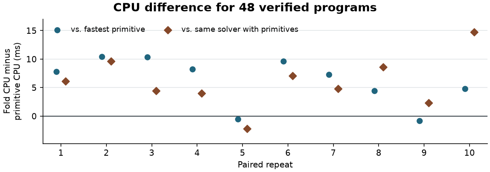

# When two answers can use the same bit

On November 15, 2026, all five solvers identified the minimum width from the two truth tables and returned correct circuits. Every shared rule used one bit and every matched rewiring required two. The supplied fold cost **106.795 ms of CPU** to return all 48 verified programs. The fastest primitive method cost **99.823 ms**. The fold used **6.98% more CPU** and won two of ten paired runs. The experiment stopped at the supplied-fold test. [Measured results](../../artifacts/FOLD-TWO-OUTPUT-20261115-001/FOLD-TWO-OUTPUT-20261115-001-E001_joint_tables/result.json)

## What the bit carries

Consider a five-input example. The first output is `h AND d`, the second is `h XOR e`, and `h = (a AND b) XOR c`. One wire carrying `h` from the three inputs is sufficient for both answers. Change only the second consumer to use `h′ = (a AND c) XOR b`. Set `a=0, d=1, e=0`: the two outputs now return `c` and `b` independently. The four possible answer pairs force four distinguishable messages from the group. Two bits suffice by sending `h` and `h′`.

The solvers received the two complete Boolean truth tables in a public input order. They knew to look for a group of three raw inputs, each affecting both outputs. They had to select the group and return a NAND circuit in which every path from those three inputs to either answer passed through the stated summary wires. Each method could cache subproblems and reuse any computed gate across the two outputs.

For any proposed group, hold its three inputs fixed and read the two residual truth tables over the outside inputs. Count the distinct residual pairs across the eight choices for the group. If that count is *K*, any correct message needs at least *K* distinguishable values. Assigning a distinct code to each pair attains the bound. The study checked the smallest achievable bit width across all eligible triples. Several triples can attain that width on a rewired task, so the circuit need not reconstruct the generator's particular triple. This is the column-count criterion from functional decomposition. [Murgai and colleagues](https://www.cecs.uci.edu/~papers/compendium94-03/papers/1994/dac94/pdffiles/26_1.pdf)

The main set comprised 24 pairs, eight each at five, seven and nine inputs. One five-input pair was a calibration case with the same first answer and an OR at the second output. Its outside inputs can likewise expose both local bits. The XOR version above was checked separately while designing the experiment. Each pair held the outside computations fixed while changing one consumer's connection. The generator selected pairs with a unique one-bit group before rewiring and a two-bit minimum afterward, so the design controls the frequency of both outcomes. In 23 of the 24 pairs every raw input affected both outputs. Each separate consumer needed only two distinct residuals at the planted triple in both conditions. The two consumers had to be considered together to distinguish the cases. The four additional tasks used a multiplexer as the local operation. [Task generator](tasks.py) · [Preregistered design](preregistration.md)

## Locating the shared bit

All five solvers selected the generator's triple on every one-bit task. They also selected it on 19 of the 24 two-bit tasks. On the remaining five they found another triple that attained the same minimum. For all the one-bit cases, both output computations had a physical path to the one summary wire. For the two-bit cases the two answers still shared at least one NAND gate in 22 of the 24 circuits returned by the matched generic solver and by the named fold.

The named and expanded versions of the fold returned identical circuits on all 48 tasks. The matched primitive solver chose the same group and returned the same number of NAND gates on every task. All three made 1,586 candidate-group trials per warm stream. The named and expanded methods each additionally tested 145 hypotheses about the supplied operation during group search, accepted 24 and rejected 121. Counting actual encoded wires that reached the outputs, the named solver used the supplied operation 64 times across 45 of the 48 programs. Both answers reused the same computation when the interface allowed it.

Nine rewired cases had more than one minimizing triple. Taking the first three inputs that affect both answers was optimal on just two of the 48 tasks. In 12 of the 24 pairs even the four-entry histogram of the two output values was identical before and after rewiring. Every method also returned the correct one- or two-bit minimum on the four multiplexer controls. The supplied fold had zero uses there.

## Work to return two verified answers

Each row covers all 48 rules. CPU and elapsed times are warm-stream medians of ten counterbalanced repetitions. The cold CPU column uses five additional repeats, rebuilding the solver and checker separately for every rule. Each stream starts with a fresh process. The physical size is the sum of the NAND counts across the 48 returned programs.

| Search method | Warm CPU (ms) | Within-stream CPU after loading (ms) | CPU in common checker (ms) | Elapsed (ms) | Cold CPU (ms) | NAND gates |
| --- | ---: | ---: | ---: | ---: | ---: | ---: |
| Primitive, find the boundary first | 99.823 | 78.356 | 29.195 | 516.145 | 143.078 | 2,461 |
| Same synthesis engine as the fold, primitives only | 100.205 | 69.813 | 25.919 | 465.370 | 124.962 | 1,511 |
| Fold expanded to its six primitive gates | 105.926 | 76.821 | 28.157 | 514.845 | 131.328 | 1,511 |
| Supplied named fold | 106.795 | 76.223 | 27.999 | 482.970 | 129.584 | 1,511 |
| Primitive, build the unrestricted shared circuit first | 138.306 | 117.303 | 12.399 | 639.866 | 179.861 | 2,461 |

The first primitive method paid less to load its implementation and produced larger circuits. The matched primitive method returned exactly as many gates as the fold, used less CPU both before and after charging setup, and finished sooner on the wall clock. It won nine of its ten paired CPU comparisons with the fold. The named fold did finish sooner on the wall clock than the first primitive method. Wall time varied on this shared host. The table reports separate medians, so timing components need not sum to the displayed median total.

The last primitive method explicitly attempted to reuse its unrestricted shared circuit on every rule. It searched its reachable gates for an admissible minimum-width interface before falling back. All 48 required fallback in that implementation. Total CPU includes those attempts. The receipts retain the gate count and attempt counters for discarded circuits and the full final programs. Exact minimum width was computed for the permitted triples. Physical NAND counts depend on the synthesis heuristic.



The full ledger includes loading solver and checker code, reading the supplied entry, initializing per-arity caches, trying candidate groups and codes, building both outputs, certifying minimum width, evaluating every original assignment, checking that no path bypassed the chosen wires, and serializing the returned program. The cost of generating the common fixtures, writing scientific traces, and the second independent replay was outside all five methods. The supplied operation was free to acquire for the primary comparison. As a sensitivity check, charging the recorded **30.916 ms** spent on the earlier eight-entry training pool gives **137.711 ms** for the fold route and a final gap of **37.888 ms** to the best primitive method. It never broke even on the 48-rule median cumulative CPU series. That earlier learner actually selected a different entry, so this sensitivity still grants the choice of the tested fold. [Earlier training receipt](../../artifacts/FOLD-DISCOVERY-20261115-001/FOLD-DISCOVERY-20261115-001-E001_learned_library/gate-freeze.json)

The experiment isolates what both outputs need to preserve under rewiring. It supplies a complete truth table, the size of the input group to search, and the decision procedure for testing a group. No policy was trained to discover that procedure. The paid speed threshold for a learned-library successor was missed. The evidence concerns these inputs and implementations.

## Replay

The 85 single-process streams ran on one pinned logical CPU of an Intel Core i7-13700KF, using Python 3.13.3. A 48-task pass covers 10,752 original assignments and 21,504 output bits. With warm, cold and operation-change repeats, the run returned 3,640 programs across 809,600 assignments and 1,619,200 output bits. There were zero failed returns. The first measured stream completed 2.8 seconds after binding, with the main pre-run work spent building the independent primitive comparators and structural checks. [Frozen sources and data hashes](../../artifacts/FOLD-TWO-OUTPUT-20261115-001/FOLD-TWO-OUTPUT-20261115-001-E001_joint_tables/design.json) · [Per-stream receipts](../../artifacts/FOLD-TWO-OUTPUT-20261115-001/FOLD-TWO-OUTPUT-20261115-001-E001_joint_tables/results.jsonl)

A separate scalar implementation replayed all 3,640 programs on the original assignments, executing 43,720,064 NAND gates. It checked all minimum-width claims and physical cuts and reproduced the cost aggregation from the saved timers. Its comparison of gate dependencies, treating the two pins of a NAND as unordered, matched the named and primitive versions of the same synthesis engine on every primary and operation-change task. [Independent audit](../../artifacts/FOLD-TWO-OUTPUT-20261115-001/FOLD-TWO-OUTPUT-20261115-001-E001_joint_tables/audit.json) · [Audit program](audit.py)

From the repository root, rebuild the numeric report from the retained receipts with `python3 -B research/FOLD-TWO-OUTPUT-20261115-001/assess.py`. To run a new timed comparison, set `exp=experiments/FOLD-TWO-OUTPUT-20261115-001/FOLD-TWO-OUTPUT-20261115-001-E001_joint_tables` and choose a fresh output directory in `out`. Run the following commands.

```bash
python3 -B "$exp/bind.py" "$out"
python3 -B scripts/longrun.py launch "$exp/job.py" --out "$out" --unit fold-two-output-joint --workers 1 --case-timeout 120 --case-mem 1G --mem-max 2G --max-cases-per-worker 1 --param "data_dir=$out" --prepare-only
python3 -B scripts/longrun.py run --out "$out" --foreground
python3 -B research/FOLD-TWO-OUTPUT-20261115-001/assess.py "$out"
```
