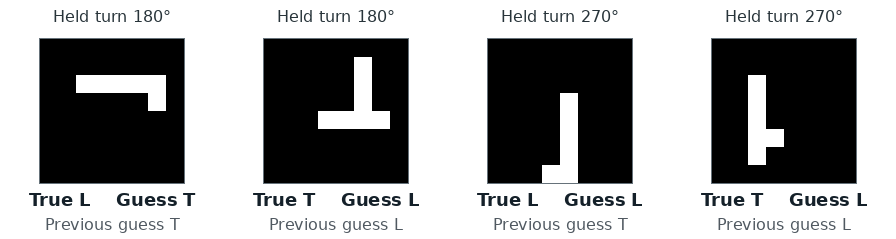

# Can reward teach L and T at an unseen turn?

**Both laws failed the frozen transfer test.** On two stroke designs withheld completely from training, each learner got 128/128 at the two training orientations, including 64/64 at new positions. At the two unseen orientations it got 32/128. Turning a letter 180° reversed the guesses for both letters. At 270° the learner called every letter L. The earlier orientation-specific reader, retrained on the same 64 images, got 16/128 on those turns. Fair guessing has an expectation of 64/128.

| Scope | Verdict | Why |
| --- | --- | --- |
| This attempt · recognize letters at unseen turns | **Status: Failed** | 4 of 16 required cells passed under each law |
| Local direction · reward-ranked groups of pixel counts | Retire this frozen rule | The smallest perfect training groups changed meaning with the turn |
| Broader exploration · learning from raw pixels | Known alternatives | Larger groups tied on the training evidence |
| Long-term goal · G15 Learning in a knot pattern | Obstruction learned | Reward selected and stored an effective clue for familiar turns |

## The blind comparison

Every cell reports correct/total for true L or true T. The two laws gave identical guesses on every bitmap. The previous approach means its original full-histogram mean reader under the corresponding law, fitted from a cleared state. Training and test used balanced, noise-free 8×8 bitmaps. L and T had equal ink within each design. Two turns and eight positions were reserved, and two complete stroke designs (E and F) were withheld even at familiar poses. All 768 bitmaps were distinct, including the 64 used in training, and none shared a shape up to rotation and translation with the 400 previously examined. Every E/F test image had a local-count signature absent from training. [Panel census](audit/panel_census.json) · [Frozen protocol](preregistration.md)

| Globally new designs E and F | Positions | Each law, L | Each law, T | Previous, L | Previous, T |
| --- | --- | ---: | ---: | ---: | ---: |
| 0° and 90° | Familiar | 32/32 | 32/32 | 32/32 | 32/32 |
| 0° and 90° | New | 32/32 | 32/32 | 32/32 | 32/32 |
| 180° | Familiar | 0/16 | 0/16 | 0/16 | 0/16 |
| 180° | New | 0/16 | 0/16 | 0/16 | 0/16 |
| 270° | Familiar | 16/16 | 0/16 | 8/16 | 0/16 |
| 270° | New | 16/16 | 0/16 | 8/16 | 0/16 |

The 16 primary cells split the two held turns by true letter, design and position condition. The prespecified threshold was strictly above half in **every** cell under each law. The only passing cells were 270° L for both designs and both position conditions (8/8 each). The other 12 were 0/8. The sensor gives each translated copy the same counts. Each cell therefore counts eight bitmaps of one shape at one turn. No independent-trial inference is warranted from those translations.

| New bitmaps of training designs A–D | Positions | Each law, L | Each law, T | Previous, L | Previous, T |
| --- | --- | ---: | ---: | ---: | ---: |
| 0° and 90° | Familiar | 32/32 | 32/32 | 32/32 | 32/32 |
| 0° and 90° | New | 64/64 | 64/64 | 64/64 | 64/64 |
| 180° | Familiar | 0/32 | 0/32 | 0/32 | 0/32 |
| 180° | New | 0/32 | 0/32 | 0/32 | 0/32 |
| 270° | Familiar | 32/32 | 0/32 | 16/32 | 0/32 |
| 270° | New | 32/32 | 0/32 | 16/32 | 0/32 |

These 448 secondary images included 192 at familiar turns with training-seen count signatures. All 256 secondary images at held turns had new signatures. The scored record also gives the earlier reader, chance benchmark through the balanced denominators, cleared readers, reward controls, individual shape cells and digest-selected examples. [All counts and examples](../../artifacts/LEARNED-PATCH-GROUPS-20261122-001/LEARNED-PATCH-GROUPS-20261122-001-E001_groups/scored/scores.json)

## What the reward selected

Each of the 64 row-major bits came straight from the bitmap. The supplied wiring counted all 81 overlapping two-by-two windows, including the padded boundary. The learner could group any of the 16 observed pattern categories. A fixed update searched all 32,767 nontrivial partitions, ranked their sums by class separation relative to within-class variation, and favored fewer categories when ranks tied. With binary guesses, the one correctness bit tells the learner which action earned reward. The same 64 images, in the same order, supplied 64 rewards to each reader. Angle, rotation operations, templates and the earlier four-pattern clue were absent from the fitting and guessing interfaces. [Reader](../../experiments/LEARNED-PATCH-GROUPS-20261122-001/LEARNED-PATCH-GROUPS-20261122-001-E001_groups/learner.py) · [Released fit and receipts](../../artifacts/LEARNED-PATCH-GROUPS-20261122-001/LEARNED-PATCH-GROUPS-20261122-001-E001_groups/fit/release.json)

Two one-pattern groups tied. In the table, the slash separates the upper and lower rows in a two-by-two window. Counts are the exact occurrences in **every** training image of that class. Each selected pattern votes for the letter whose training count is closer. The two votes agreed on all 704 test images, including all mistakes. [Fitted groups and class totals](../../artifacts/LEARNED-PATCH-GROUPS-20261122-001/LEARNED-PATCH-GROUPS-20261122-001-E001_groups/fit/diagnostics.json) · [Individual votes](../../artifacts/LEARNED-PATCH-GROUPS-20261122-001/LEARNED-PATCH-GROUPS-20261122-001-E001_groups/blind/rule_votes.json)

| Learned pattern | Lit positions in that window | L count | T count |
| --- | --- | ---: | ---: |
| `01/00` | Upper right only | 1 | 2 |
| `11/01` | Every position except the lower left | 0 | 1 |

A training-only inspection after release found **240** different partitions with perfect separation and zero within-class variation. Twelve preserve their membership under a quarter-turn. The earlier clue, counting all four arrangements with three lit pixels, was among them, with training counts of one for L and two for T. The supplied preference for smaller groups eliminated it. The training rewards gave no separation advantage to that larger group. The changed meaning of the two selected counts at unseen turns locates the failure in rule selection from the available experience. [Descriptive rank comparison](audit/postscore_rank_support.json)

The images are selected by smallest bitmap digest for each true class and held turn at new positions on the globally new designs. On the first L, the learned counts were 2 and 1. Both votes therefore said T. The third image is a correctly classified L with counts 1 and 0. The fourth image is a T with exactly those same two counts. Fixed wiring and a fixed recipient reproduce these guesses from the saved words. [Single-image replay](replay_guess.py)

## What the knots did

Each reader had 40,494 independent ternary knots in a fixed arrangement. One place stored its phase, 7,296 stored the training receipts, 430 held the class sizes and per-class totals, and 32,767 held the possible group membership flags. Finalization erased the individual receipts. The retained class totals and two marked choices determined all future votes. The full open law was even parity in one reader and not-all-equal in the other. Both passed K1–K3 on the checked operational projections. A prepared pair of distinctions forced a unique read in each law. The two prepared codewords alone failed the open-knot test. The program supplied addresses, writes, the group search, arithmetic and vote. A separately written integer implementation gave the same guesses on every test image under all three reward schedules. [Holding checks](../../artifacts/LEARNED-PATCH-GROUPS-20261122-001/LEARNED-PATCH-GROUPS-20261122-001-E001_groups/knot_checks.json) · [Ordinary implementation](../../experiments/LEARNED-PATCH-GROUPS-20261122-001/LEARNED-PATCH-GROUPS-20261122-001-E001_groups/ordinary.py)

| Intervention on the same 704 bitmaps | Result under each law |
| --- | --- |
| Exchange full states between opposite reward meanings | All 704 guesses reversed in both directions |
| Sham exchange and restore original state | All 704 original guesses recovered in both recipients |
| Clear the entire state | All 704 guesses became the default bit, L in the ordinary convention |
| Clear only the chosen group flags | 256/704 guesses changed with class statistics held fixed |
| Mark all 16 singleton groups, retaining class statistics | 0/128 correct on E/F at held turns |
| Shift the reward assignments by 17 training presentations | 30/64 teaching bits changed. Three different groups won. Held-turn E/F score was 64/128 |

The opposite-reward fits selected the same two groups and reversed their class counts. The shifted rewards changed which groups won. Permuting anonymous category names preserved all selected partitions after undoing the renaming and preserved all votes on the 48 distinct test signatures. The causal exchange establishes that stored knot state controlled the guesses. The agreement with integer arithmetic accounts for their content under both laws. [Independent fit, interventions and replay](audit/replay_result.json)

**Next step:** Research directions — No next action selected.

| # | Direction | Payoff | Concreteness | First step → stop when | Status |
| --- | --- | --- | --- | --- | --- |
| 1 | Disambiguate equally good training clues | 2/3 | 2/3 | Add independently drawn strokes at training angles → check whether single-pattern shortcuts survive | Alternative · deferred |

**STOP.** The requested two-law test is complete. Additional drawing variation could distinguish the competing clues without supplying a turn rule. Its value depends on which clues survive those new examples and would require another blind panel.

**Corrections:** None.  
**Goals:** G15 gained evidence that reward selects knot-held pixel distinctions and that perfect training separation can select an orientation-specific clue.  
**Assumptions:** A207 records the drawing population, weighting and group selection.  
**Scaffolds:** Position sharing, the separation score, preference for smaller groups, physical writes and the nearest-mean vote were supplied. Scientific referee pending.

