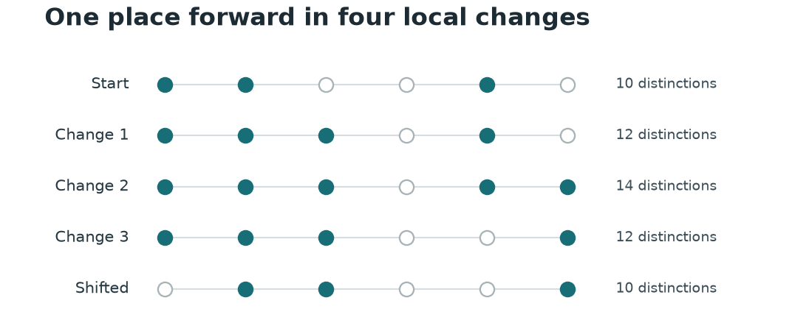

# A pattern can travel through a fixed ring attachment

A single parity state can carry its own direction. On a uniform stretch its smallest moving form in the closed four-response family occupies ten distinctions. One of four least changes is possible at each successive phase. After all four it has the same shape one knot (junction) farther along. On a 31-knot ring it visits 31 different places and returns to exactly the same state after 124 changes, then repeats forever. An isolated pattern needs neither a global tick, a past state nor an outside choice of destination. The binary reference and the local update law are supplied. Growth alone supplies the places and the allowed changes.

## What plays the part of next?

| Reading | What it needs | Smallest observed or proved motion | Order and lifetime |
| --- | --- | --- | --- |
| A0, compare complete cluster layers | The inclusion of the smaller layer | The old four-distinction response stays where it was | No change on old distinctions is selected |
| A1, follow growth | One directed parent–child meeting in the growing end | The one shared distinction marks a new meeting a knot step farther on each continuation. A four-distinction square follows with one layer of lookahead | No tick. On the 17- and 81-knot backgrounds the inward mark approaches the far landmark for 8 and 40 steps. Eventually it recedes from every fixed old landmark. A bare ring repeats its source phase on newly made knots |
| B, update one allowed state | A fixed allowed reference, current nearness and four reversible least responses used under directed enabling conditions | Three occupied response locations, ten actual distinctions. The four firings pass through weights 12, 14 and 12 back to 10 | One eligible event everywhere on the isolated 31-ring orbit. Two opposing pulses on the long background can terminate differently under fair schedules |
| C, carry the arriving distinction | One four-distinction response and its entering distinction | One ordinary knot step per handoff. Each handoff moves a four-distinction copy by changing six physical distinctions, equivalent to two least-response firings | On five- and 31-rings its full marked state repeats every five and 31 handoffs. The strict rule stops on a tie. Keeping every exit gives the same set under every fair order and can branch |
| B on the mutually identified through legs | B and a local test for which legs return to one another | The same ten-distinction pulse keeps heading in its own shape. No entering distinction is stored | Passes intact five-rings at the same pace as a plain stretch. A cut can halt it before the seam |

**The minimum has a scope.** On a zero-loose homogeneous background of ordinary four-responses, k occupied locations in j runs use 2(k+j) true distinctions. One location, two locations or a single run has a reflection fixing the state, which prevents it from choosing one direction. The first asymmetric choice attaining the bound has three locations in two runs. Moving a copy one place then requires at least four firings. Even the minimum peak weight is sharp at fourteen. The proof fixes the events, symmetries and reference assignment. There are two-distinction changes on loose values, and states with extra marks or larger programmed listening windows have different costs. Among all programs no universal measure of a rule's size was assumed. [Minimality, time counts and alternate references](minimality.md)

The complete four-phase sequence starts at locations {0,1,4} along the stretch. Toggle 2, then 5, then 4, then 0. The new pattern {1,2,5} is precisely the old one one place on. These numerals locate the example for its reader. The update identifies the occupied shape or its reflection and takes neither numbers nor direction as inputs. All 32 rules based solely on an overlap count were compared. None forces this translation. All reflected rooted-word rules were tested through radius three for returning shapes of span at most eight with at most five occupied slots and periods 2, 4, 6 or 8. None gives a unique advancing orbit in those limits. A subsequently derived radius-four word rule does give the four phases. The registered implementation used radius six. [Executable rule, finite search and collision witnesses](b_updates.md)

## What happens at one or two eddies?

The attachment supplies three exits to a pulse arriving along the background. The strict rule halts. The all-exit rule sends arrivals both ways around the ring and onwards. At an intact five-ring the two ring legs visibly meet again. The remaining leg continues the background. This test uses step-one nearness of distinctions sharing a knot, reconstructed under arbitrary renaming. In the induced old-knot neighbourhood, one step permits three images of the forward exit. With two steps there is just one. On longer single rings the exact radius for that neighbourhood reading is floor(half the ring length), under the stated plain-arm hypotheses. The restricted bond distance worked on the 12 completed path tables. A separate static control showed that the full bond-distance table need not determine the exit for arbitrary arrangements. [Readings at the attachment](nearness.md) · [Sharp local radius](seam_radius.md)

The carried four-distinction pulse passes the intact single and both intact double attachments at separations 4, 8 and 20. The added current-state rule combined this return test with B after their separate outcomes were known. It was committed before scoring the two fresh 85-knot background holdouts. In the intact case, the two attachments were 26 source steps apart. Among all 158 oriented launches, 56 completed a shift across both seam landmarks. The outer launches each completed 78 steps in either direction, using 312 elementary events and one further partial event at the boundary. With the first ring cut, all 148 starts were checked. No pulse crossed the cut, and 54 crossed the remaining intact attachment. The weighting in these counts gives one vote per eligible oriented launch in the indicated finite stage. The pulse has the same shape and speed through one or two successfully traversed seams. No reflection arose under strict or through routing; branching is the explicit all-exit choice. [Second freeze](composition_freeze.md) · [Holdout receipts](../../artifacts/MOTION-AT-EDDY-20261119-001/MOTION-AT-EDDY-20261119-001-E001_motion/composed_motion.json)

No one of these updates changes the rate of either ring or of the whole. This holds at every cluster size: the growth law reads knots, shared distinctions and available places, all fixed by an assignment change. There is a different interaction the allowed states permit. The closed state on one five-ring can be transferred to a second five-ring d steps apart in **exactly 2d+10** least four-distinction changes if loose distinctions may change temporarily. Shortest checked witnesses cost 18, 26 and 50 changes at separations 4, 8 and 20. The passing rule only fires ordinary responses and preserves the state stored on each ring. A self-directed exchange requires an additional enabling law. [Invariant and shortest-transfer proof](ring_state.md)

## Speed, growth fate and evidence boundaries

Speed here counts ordinary source-knot steps per specified event. The uniform isolated B pulse makes one step per four firings both far from and through a passable attachment. A directed C handoff makes at most one step anywhere, sharp both near and far. Its support reaches up to two co-knotted-distinction steps from the preceding support. A stall has zero onward speed. On an otherwise empty homogeneous stretch, any reflection-respecting law with one uniquely enabled firing and reading radius s has mean shift at most (s−1)/2 places per firing for any translated finite pattern. This upper bound need not be sharp at fixed s. A written growth trace moves by at most one parent–child step per new cluster size. There is no numerical ceiling across all finite local laws if the reading radius and pattern span may increase. The scaled four-phase templates give s steps per four elementary firings with a radius of 6s. No elapsed-time speed follows. The word “dimension two” refers here to cumulative knot growth in the background. The pulse uses one of its identifiable stretches. [Speed proof](minimality.md) · [Support and directed speeds](transport.md)

**Fate fixed before testing.** CHAIN-IDENT's tree formula gives the 17- and 81-knot backgrounds 17+2t and 81+2t births at size t+1, hence cumulative dimension two. RING-CORES gives the bare five-ring and 31-ring constant 5 and 31 births per layer, and the one- and two-leftover five-rings size factors 1.134724 and 1.262775. The complete identified join map (CHAIN-IDENT and DOUBLE-IDENT with the ring identification theorem) gives exponential growth for J0, J1, J2, J81 and T4, T8, T81. C1 has cumulative dimension three. The intact holdout has a rank-three map and four endless chains. The cut holdout has a rank-one map and five endless chains and retains an intact one-leftover ring with exponential confined growth. Both therefore grow exponentially, with an upper bound from finite degree in the unrolled map. The perturbation introduces no new source. [Source fates and exact rates](../EDDY-WORLD-20261119-001/theory_fate.md) · [Additional source certificates](layers.md)

**Exhausted.** Fourteen fixed size-two stages, from 10 knots and 25 distinctions to 192 and 556, supply 485 ordinary responses, 650 unit overlaps and 2,899 distinct target readings. We enumerated all 32,768 closed states on the short background, all 64 on the bare five-ring, all 1,300 directed launches of the strict carried law and all 904 launches of the return rule. The layer proof classified 1,028 source launches. Literal tests covered all 24,081 directed meetings with a scored successor across the archived layers, reaching cluster size 33 in the longest archives. A fresh one-size-past check of the earlier shift reached 1,784 knots and 10,767 distinctions at cluster size eight. The two new scattering stages contain respectively 200 and 202 knots and 576 distinctions each. All launches of the registered shape on their paired stretches were tested. This is an exhaustive result for these starts, launch sets and rule bounds. The 16 named starts are purposive samples. There is no weighting over starts or estimate for other worlds. [Physical inventories](patterns.md) · [Layer-by-layer bounds](layers.md)

**Proved and open.** The single-packet translation, sharp costs in its closed family, stationary structural rates, distinction between layer comparison and state updates, fixed-rule speeds, and the two-ring transfer cost have arguments at the stated scopes. Exhaustive receipts supply the finite scattering and scheduler outcomes. No claim of global order independence for the one-state rule survives the two-pulse control. Reading all exits to closure *is* independent of processing order, though its explored set can grow. The preregistration advisor's tentative four-location minimum failed against the reflected three-location construction. The independent program referee is pending. The general mathematical question of asynchronous update-order independence has an existing literature; this study's claims concern its specified parity responses and egress choices. [Gács, on independence of asynchronous updating](https://arxiv.org/abs/cs/0101026)

A pattern can move here. Four local changes put the same shape one meeting farther along. It can circle back to the same distinctions indefinitely, and it can pass two self-feeding rings by reading where their arms rejoin. The knots making either ring remain in place. Their rate comes from how they meet. To make an eddy itself move, an allowed local change would have to rebuild those meetings at the next place and release the old attachment while the same self-feeding loop remains recognizable.

| Scope | Verdict | Why |
| --- | --- | --- |
| This attempt — motion past an eddy | **Status: Successful** | One current state crosses two fixed attachments |
| Local direction — least allowed changes | Continue | Two rings can exchange a stored state at an exact cost |
| Broader exploration — dynamics inside growth | Known alternatives | Directed transport and branching give different interactions |
| Long-term goal — G5 Dynamics | Capability gained | A local event law carries a persistent state pattern |

**Next step:** Continue — selected: #1

| # | Direction | Payoff | Concreteness | First step → stop when | Status |
| --- | --- | --- | --- | --- | --- |
| 1 | Let an arriving pulse switch which ring is occupied | 3/3 | 2/3 | Use the 18-change witness on the four-step pair → autonomous exchange or an unavoidable first tie in a declared local rule class | Selected · started |
| 2 | Make two passing pulses independent of event order | 2/3 | 3/3 | Replay the 20-state encounter with a local collision rule → common outcome or two fair counterexamples | Alternative · deferred |

The first direction would give G5 a response stored in the world after passage. The shortest witness and its lower bound have been obtained here. Its local choice of events remains open. The second has a small exact counterexample to start from, and would settle whether two pulses share a well-defined outcome under the enlarged rule class.

**Corrections** — None to earlier results. The permitted four-distinction shift passed its one-size-past check.

**Goals** — G5 Dynamics gained a current-state motion law and a test for an active interaction.

**Assumptions** — A111 records the fixed allowed reference for the single-state reader. Changing the reference together with the state preserves the result.
