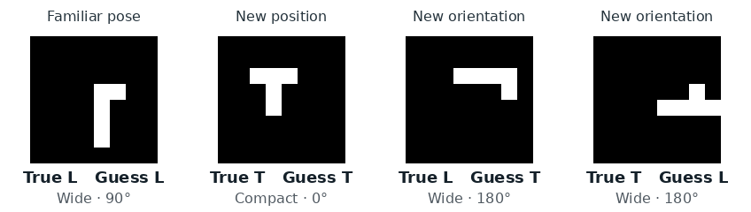

# Learning L and T from raw pixels

Reward taught the reader which ordered two-by-two pixel patterns occurred more often in each letter. It classified every fresh image at the two training orientations, including all 72 images at new positions. At the two untrained orientations it got 50 of 200 right and missed every T. The first failure was using what it had learned after a turn. The counts still contained information that distinguished all the letters. [Prospective design](preregistration.md) · [Independent replay](audit/replay_result.json)

| Scope | Verdict | Why |
| --- | --- | --- |
| Classify a fresh L or T | **Status** · Partially successful | 136/136 at familiar orientations, 50/200 at new ones |
| Store the acquired distinction in knots | Successful on this apparatus | Exchanging only the learned marks reversed 336/336 guesses |
| Other ways to compare the same images | Known alternatives | An ordinary integer reader reproduced the decisions |
| G15 · Learning in a knot pattern | Capability gained | Image experience changed a later action through stored knot state |

## Which images were recognized

Rows for the two knot laws were identical. Fractions give correct guesses divided by all images of that class in the condition. Both fitted label conventions had the same accuracy after interpreting the bit in its own convention. The cleared reader always issued bit 0, which means L in the ordinary convention. The fair-guess column is an expectation, and every score for a fitted or cleared reader is an observed count. [All cells, including style and turn](../../artifacts/PIXEL-LETTERS-20261122-001/PIXEL-LETTERS-20261122-001-E001_letters/scored/scores.json)

| Test condition | Knots, L | Knots, T | Raw nearest neighbor, L | Raw nearest neighbor, T | Cleared, L / T correct | Fair guess, expected total correct |
| --- | ---: | ---: | ---: | ---: | ---: | ---: |
| Other stroke style at the same training pose | 32/32 | 32/32 | 20/32 | 20/32 | 32 / 0 | 32/64 |
| New position, familiar orientation | 36/36 | 36/36 | 13/36 | 14/36 | 36 / 0 | 36/72 |
| Familiar position, new orientation | 32/64 | 0/64 | 20/64 | 15/64 | 64 / 0 | 64/128 |
| New position and new orientation | 18/36 | 0/36 | 13/36 | 13/36 | 36 / 0 | 36/72 |

Training used 32 Ls and 32 Ts, with five lit pixels in every image and every style represented in both familiar orientations. The remaining 336 bitmaps were all distinct from training and each other. The finite generator exhausts 25 anchors, four turns, two drawing styles and two classes. There is a genuine fresh bitmap at every familiar training pose because the other stroke style was reserved there. Across all test images the knots got 186/336 and raw nearest neighbor got 128/336. The denominators weighted by position conceal the large difference between familiar and untrained turns. [Frozen panel](../../experiments/PIXEL-LETTERS-20261122-001/PIXEL-LETTERS-20261122-001-E001_letters/panel/manifest.json)

The 64 fresh familiar and 72 new-position images all had two-by-two counts that had already occurred for their own class in training. All 200 images at new orientations had unseen counts. There were eight distinct count signatures in training and eight additional ones among the held turns. Each class, style and turn produced one signature across all 25 anchors. At 180° the reader interchanged both letters, scoring 0/100. At 270° it called every image L, scoring 50/100. No fitted decision was tied. [Independent counts and all raw guesses](audit/replay_result.json)

## What the knots learned

The sensor delivered 64 bits in row-major order. Fixed wires grouped every overlapping two-by-two patch, with a one-pixel black border. A four-bit address identified each of the 16 possible local patterns. Counts were shared across position. Training supplied a correct/incorrect reward after the reader guessed. With only two choices that receipt identified the correct action. The update added the observed counts to that action's bank. No class name, pose, template, prepared stroke feature or learned encoder reached the knot reader. [Sensor, write and read](../../experiments/PIXEL-LETTERS-20261122-001/PIXEL-LETTERS-20261122-001-E001_letters/learner.py)

Nine of the sixteen pattern frequencies differed between the learned class means. For example, a patch with **only its right column lit** occurred 64 times in the 32 training Ls and 16 times in the 32 Ts, averages of 2 and ½. A patch with **all pixels lit except the bottom-left** occurred in the T bank 32 times and in the L bank zero times. The blank patch averaged 69 in both classes. The readout compared all 16 frequencies at once. Each training example changed the physical memory. The ordinary learner issued 62 correct guesses during its 64 updates and the separately trained opposite convention issued 61. [Physical word](../../artifacts/PIXEL-LETTERS-20261122-001/PIXEL-LETTERS-20261122-001-E001_letters/fit/parity-ordinary.json) · [Per-presentation receipts](../../artifacts/PIXEL-LETTERS-20261122-001/PIXEL-LETTERS-20261122-001-E001_letters/fit/receipts.jsonl)

All retained experience in a knot reader was in **32 count registers, each made of 13 ternary knots**. The fitted code and numbered addresses were fixed. A write offered a mark and dock, and the holding's law had to admit a unique read. The ordinary read checked that completion at each bit and decoded the counts anew. Class sizes followed from the count totals. The program supplied the write arithmetic, squared discrepancy to each class mean, tie rule and output action. Predictions from a fresh receiver used the frozen holding words alone. Both laws yielded the same counts, and the conventional integer implementation matched every training guess and all 336 decisions under both conventions. [Ordinary control](../../experiments/PIXEL-LETTERS-20261122-001/PIXEL-LETTERS-20261122-001-E001_letters/conventional.py) · [Physical state and exact agreement](audit/replay_result.json)

The full hardware relation at a holding passed K1–K3 under even parity (four allowed words) and not-all-equal (six). The operational check exposed all eight candidate triples at an actual holding while keeping the other 415 fixed. Training used two prepared words of each law. Zero was `110` under both laws. One was `011` under parity and `001` under not-all-equal. For example, offering the first two marks `00` forces a read of zero under parity and one under not-all-equal. The two-word preparations by themselves failed K2. The law constrained each bit write and read. Pattern grouping, reward credit and nearest-mean comparison were supplied operations. The run showed no computational advantage over ordinary count storage, and it tested no growth or rewiring of knots. [Canonical checks and negative controls](../../artifacts/PIXEL-LETTERS-20261122-001/PIXEL-LETTERS-20261122-001-E001_letters/knot_checks.json)

## Correct guesses, mistakes and exchange

In the second image above, the compact T at a new position had squared discrepancies **6½ to the L mean and 2 to the T mean**. The reader chose T. With the same pixels, wiring and output convention, replacing only the registered words with the opposite-trained words produced L. Clearing them produced L. Restoring them produced T. Raw nearest neighbor also guessed L. The fourth image is a wide T at 180°. Its discrepancies were **10½ to L and 14 to T**, so the same learned rule gave the wrong answer. The figure uses the first bitmap by the frozen ID order within each displayed cell and outcome. [Run these decisions from the marks](replay_guess.py)

Every one of the 336 images received opposite guesses from the two separately trained conventions, with both laws. Both directions of memory exchange reproduced the donor guess in every case. Sham writes and restoration preserved every original guess. Clearing all counts made both receivers issue 0 throughout. Thus the words determined which guess the reader made, including on images it misclassified. [Blind predictions before their labels were joined](../../artifacts/PIXEL-LETTERS-20261122-001/PIXEL-LETTERS-20261122-001-E001_letters/blind/predictions.jsonl) · [Phase locks](phase_anchors.jsonl)

After scoring, we inspected the frozen local counts to locate the rotation failure. Summing the four possible arrangements of **exactly three lit pixels** gave one patch in each of the 200 Ls and two in each of the 200 Ts, across both training and test. The register addresses had preserved this distinction. The fitted readout compared the orientations separately and failed to use that sum. This is a descriptive observation on the released panel. The reader never received that rule or a second fit. [Post-score check](audit/postscore_pooled_counts.json)

## Evidence and stopping point

The Fable advisor returned its weekly limit. A separate fresh-context Astra reviewer approved the design before fitting, and a second reviewer reconstructed the panel, all 448 training updates across seven arms and all 7,728 blind actions. The authorization and replay audits passed. The formal scientific referee has the record for review. The freezes are content hashes with observable phase order in this trusted workspace. [Design review](design_review/red_team_report.json) · [Run approval](audit/R1/red_team_report.json) · [Independent replay audit](audit/R2/red_team_report.json) · [Referee handoff](referee_handoff.md)

The three official single-process stages used 0.088 s for training, 0.764 s for blind prediction and 0.009 s for scoring on this host. The highest reported process memory was 21,384 KiB. The four trained knot words occupied 1,692 or 1,695 bytes of JSON each. The integer twin occupied 270 bytes and raw nearest neighbor 5,571 bytes. These are serialization sizes and process measurements for this implementation. The costs include issuing actions for the declared controls. [Fit](../../artifacts/PIXEL-LETTERS-20261122-001/PIXEL-LETTERS-20261122-001-E001_letters/fit/release.json) · [Blind release](../../artifacts/PIXEL-LETTERS-20261122-001/PIXEL-LETTERS-20261122-001-E001_letters/blind/release.json) · [Scorer release](../../artifacts/PIXEL-LETTERS-20261122-001/PIXEL-LETTERS-20261122-001-E001_letters/scored/release.json)

**Next step:** Research directions — No next action selected.

| # | Direction | Payoff | Concreteness | First step → stop when | Status |
| --- | --- | --- | --- | --- | --- |
| 1 | Learn which rotated patterns to count together | 2/3 | 2/3 | Train on fresh glyphs → test a new turn | Alternative · deferred |

**STOP.** This one comparison isolated a failure of transfer despite sufficient local pixel information. Learning which counts to combine would test a different update and readout on fresh data.

**Corrections:** None.  
**Goals:** G15 gained a finite demonstration of image-dependent knot memory.  
**Assumptions:** A205 records the generator, weighting and prepared reader.  
**Scaffolds:** Image layout, patch grouping, translation sharing, reward update, binary storage code and mean comparison were supplied. Reversing the reward convention reversed the learned decisions under both holding laws.

