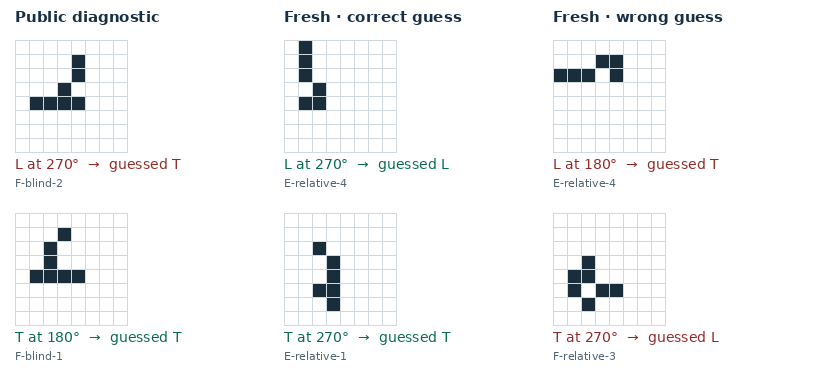

# Relative pixel positions separate the public drawings. The trained tree calls both T.

**STOP.** With either even parity or not-all-equal, the position-aware reader correctly classified **12 of 32 distinct held-turn drawings**. The previous window-count group reader recognized 16/32 and a tree with the same fitting rule on those counts recognized 15/32. The balanced chance expectation is 16/32. On the earlier public 270° L and 180° T, six occupied offsets differed. Both inputs nevertheless reached the same learned T leaf. These public cases are excluded from all fresh counts. [Frozen protocol](preregistration.md) · [Scores](../../artifacts/RELATIVE-PIXEL-READ-20261122-001/RELATIVE-PIXEL-READ-20261122-001-E001_relative/scored/scores.json) · [Public-pair traces](../../artifacts/RELATIVE-PIXEL-READ-20261122-001/RELATIVE-PIXEL-READ-20261122-001-E001_relative/pair/predictions.jsonl)

| Scope | Verdict | Why |
| --- | --- | --- |
| This attempt · relative pixels on unseen turns | **Status: Partially successful** | The sensor separated the public pair. The trained tree called both T and recognized 12/32 fresh held drawings. |
| Local direction · positive-gain trees of aligned pixels | Retire on this training stream | Two uniquely selected tests lead to a pure training branch that merges eight held Ls with seven Ts. |
| Broader exploration · learning visual distinctions from reward | Known alternatives | Learning relations among pixels would change which distinctions the reader can choose. |
| G15 · Learning: a point in a learned knot pattern | Obstruction learned | Changing only the knot-held state controlled the decisions. Familiar-angle rewards reinforced a rule that failed after a turn. |

## Blind results

Training used the same 64 familiar-angle presentations in the preceding varied arm, with 16 Ls and 16 Ts at each of 0° and 90°. All three readers received an identical sequence of own guesses and correctness bits per convention. The blind census used eight new paired stroke designs, four of six lit pixels and four of seven. Ink count, bounding box and placement were matched within each pair. The design selection used ordered pen paths and geometric checks. Diagonal steps were permitted. The sixteen fresh base letter shapes were disjoint under translation, quarter-turns and reflections from all 2,240 earlier bitmaps. Each of the 32 held drawing/letter/turn units appeared at 16 anchors. The halves comprise eight familiar and eight new anchors. Every translation of a given unit received exactly the same decision in all 48 columns. [Panel and exact stroke paths](../../experiments/RELATIVE-PIXEL-READ-20261122-001/RELATIVE-PIXEL-READ-20261122-001-E001_relative/panel/manifest.json)

| Held turn and letter | Position-aware tree | Same tree on window counts | Previous window groups | Position-aware, familiar anchors | Position-aware, new anchors |
| --- | ---: | ---: | ---: | ---: | ---: |
| 180° L | 0/8 | 3/8 | 0/8 | 0/64 | 0/64 |
| 180° T | 7/8 | 3/8 | 8/8 | 56/64 | 56/64 |
| 270° L | 3/8 | 3/8 | 2/8 | 24/64 | 24/64 |
| 270° T | 2/8 | 6/8 | 6/8 | 16/64 | 16/64 |
| **Total** | **12/32** | **15/32** | **16/32** | **96/256** | **96/256** |

The first three score columns count distinct drawings per turn. Table entries apply separately to each law. The strict gate required a majority in every design, letter, held turn and placement regime. The position reader passed 24 of these 64 cells, the matched count tree 30, and the previous reader 32. Each failed. Relative to the matched tree, the position reader gained seven distinct decisions and lost ten. Against the previous group reader, it gained two and lost six. The paired bitmap counts were 112 gains/160 losses and 32 gains/96 losses, respectively.

| Common blind population | Position-aware tree | Same tree on window counts | Previous window groups |
| --- | ---: | ---: | ---: |
| Fresh design, familiar turn, familiar position | 176/256 | 168/256 | 184/256 |
| Fresh design, familiar turn, new position | 176/256 | 168/256 | 184/256 |
| Fresh design, unseen turn, familiar position | 96/256 | 120/256 | 128/256 |
| Fresh design, unseen turn, new position | 96/256 | 120/256 | 128/256 |

Across both position regimes, the position tree recognized 22/32 distinct drawings at the two familiar angles and 12/32 at the two unseen angles. The tests concern this fixed pen grammar and training set. Some strokes have only diagonal continuity. Translation invariance was built into each sensor.

## Learned tests and the public pair

The new sensor puts the minimum occupied row and column at zero and records all 64 relative occupancies in their original axes. The old sixteen window counts coincide on the public pair. The new vectors differ at zero-based addresses 2, 3, 9, 11, 17 and 18. The group reader called both T. The matched window tree called both L. Both laws of the position tree called both T, correctly labeling the public T alone. [Full sensor vectors](../../artifacts/RELATIVE-PIXEL-READ-20261122-001/RELATIVE-PIXEL-READ-20261122-001-E001_relative/sense/sensors.json)

The position tree fit 61/64 acquired targets. It learned to look first at relative row 2, column 0. When dark, it next checked row 0, column 0. When both were dark, **all 18 training examples were T**. Both public images followed that route. On the held turns, eight distinct L drawings and seven Ts reached the same leaf, all called T. The two tests were uniquely best on their training nodes. Extra depth cannot split that pure branch with positive Gini gain. Across the tree the six split addresses, in root, left, left-right, right, right-left and right-right order, were 16, 0, 8, 18, 9 and 8. At the last split alone, addresses 8 and 19 tied and the lower address won. The matched count tree fit 60/64. The actual historical group reader reproduced its former selected two-pattern group and all six previous physical/arithmetic checkpoint payloads. [Decoded tests, counts and ties](../../artifacts/RELATIVE-PIXEL-READ-20261122-001/RELATIVE-PIXEL-READ-20261122-001-E001_relative/interpretation.json) · [Frozen fitted states](../../artifacts/RELATIVE-PIXEL-READ-20261122-001/RELATIVE-PIXEL-READ-20261122-001-E001_relative/fit/diagnostics.json)

The full relative codes distinguish all 32 held drawing units. The sixteen window counts yield 28 different signatures on these units, all class-pure within this fresh held panel. The earlier opposite-label collision remains real on its separate public examples. The seven leaves of the position tree merge enough held labels that even assigning each leaf its best vote **after reading the held labels** could give at most 20/32. The corresponding ceiling for the window tree is 18/32. These ceilings diagnose information loss in the fitted decisions. No replacement votes were fitted or issued. [Post-score signature and leaf census](../../artifacts/RELATIVE-PIXEL-READ-20261122-001/RELATIVE-PIXEL-READ-20261122-001-E001_relative/interpretation.json)

## What the knots did

Each run supplied 64 raw row-major bits and told the learner whether its own binary action earned reward. With just two actions, a miss identified the other action. The position tree under either law used 4,450 ternary holdings. During acquisition they stored the receipts. Finalization erased all 64 receipt slots and wrote the selected tests, thresholds, votes and phase. Classification read those physical words. The open even-parity relation admits four triples and not-all-equal admits six. Both passed K1–K3 at actual receipt and tree addresses. The write/read preparation uses two states of each open relation and forces the read bit. Testing those two prepared states alone fails K2. The program supplies the address layout, sensor, exact gain and tie rule, the write/read choices, the output convention and the maximum of three tests along a path. [Reader](../../experiments/RELATIVE-PIXEL-READ-20261122-001/RELATIVE-PIXEL-READ-20261122-001-E001_relative/reader.py) · [Open-law and prepared-state checks](knot_checks.json)

Holding each image fixed and exchanging the independently trained ordinary/opposite words reversed **1,024/1,024** decisions in each direction for all three readers and both laws. Sham and restoration reproduced all original guesses. Clearing the position tree yielded L on all images, changing 608/1,024 guesses. Its balanced held score after clearing was 256/512, compared with 192/512 after training. Both independent integer counterparts of the trees, and the archival arithmetic group counterpart, reproduced every fresh action of their corresponding original fits in both conventions. This is evidence for causation by the saved state. Ordinary computations account for the classifier behavior. [Word interventions](../../artifacts/RELATIVE-PIXEL-READ-20261122-001/RELATIVE-PIXEL-READ-20261122-001-E001_relative/blind/interventions.json) · [One-image replay](replay_one.py)

Astra Max approved the design before freeze. An independent implementation lane checked the geometry, time-ordered releases, 1,152 action/reward updates, 18 fitted endpoints, 96 public actions and 49,152 fresh actions, and reproduced the scoring. A fresh producer replay matched all 26 deterministic payloads byte for byte. The five producer stages together took 4.73 seconds as recorded, including 3.55 seconds to issue the fresh actions. First scientific signal was the public sensor separation at 18:30:48 UTC, about 12 minutes 33 seconds after scope initialization. The main pre-signal work was constructing and verifying a genuinely disjoint, balanced panel and the state/split implementation. Scientific referee pending. [Design review](design_review/red_team_report.json) · [Run authorization](audit/R1/red_team_report.json) · [Independent result audit](audit/R2/red_team_report.json) · [Scientific referee handoff](referee_handoff.md)

**Next step:** Full pivot — **STOP** the fixed position-tree approach on this training stream. No successor selected.

| # | Direction | Payoff | Concreteness | First step → stop when | Status |
| --- | --- | --- | --- | --- | --- |
| 1 | Increase the tree depth or rearrange tied tests | 0/3 | 3/3 | Inspect the two splits leading to the 18-T training leaf → both are unique and the leaf is pure | Retired |
| 2 | Learn a comparison among several pixel positions | 2/3 | 1/3 | Identify a training observation that can favor a transferable relation without prescribing rotation → require a new blind panel | Deferred |

The public and fresh observations contain usable distinctions. At the decisive leaf, changing the depth limit or split tie order leaves the failure in place. Selecting a new rule because it solves these released drawings would spend their independence. Reopen the branch when there is a training-side reason to favor another relation.

**Corrections:** No previous scientific claim changed.

**Goals:** G15 gained a measured distinction between information preserved by a sensor and information selected by a reward-trained knot reader.

**Assumptions:** A209 · Assumed. The common reference, tree rule and finite weighting define this experiment.

**Scaffolds:** The oriented axes, translation alignment, tree fitting and bit preparation were supplied. The choices of positions, thresholds and leaf votes were learned. A205, A207 and A208 supply the earlier controls and acquisition schedule.
