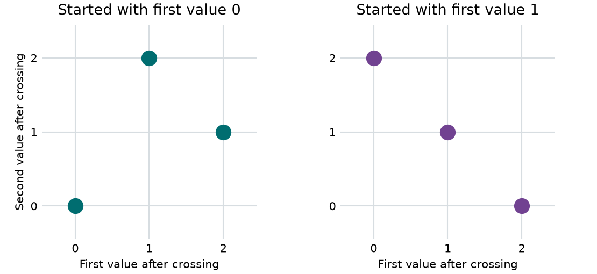

# What can a reader still untangle after a fold?

On November 14, 2026 (Pacific) the owner recalled controlling nearby strands of logic, possibly shrinking a return one opposing ring at a time or hopping across several levels. The owner then suggested “braiding and untangling” specifically for the test of what a downstream reader can distinguish. The result here is a finite example in which both strands separately retain every possible value, yet one future question becomes impossible to answer from those separate records. Which pairs of values survive carries the answer.

## A crossing that hides a distinction in the pair

Give each strand a value from 0, 1, 2. A crossing sends `(x,y)` to `(u,v) = (y, 2y−x modulo 3)`. Undo it with `x = 2u−v modulo 3` and `y = u`. This local move is an example from classical braid mathematics. On three strands the crossing sequences 12–23–12 and 23–12–23 agreed on all 27 input triples. On two strands the inverse restored all nine input pairs. Applying the forward move twice restored only the three pairs whose values were already equal. [Classical braid relation and quandle construction, section 4](https://msp.org/pjm/2007/231-2/pjm-v231-n2-p04-s.pdf) · [Experimental design](braid_design.md)

| Before crossing, with the second value free | Allowed pairs after crossing | First strand alone | Second strand alone | Possible first value after undo |
| --- | --- | --- | --- | --- |
| First value 0 | (0,0), (1,2), (2,1) | 0, 1, 2 | 0, 1, 2 | 0 |
| First value 1 | (0,2), (1,1), (2,0) | 0, 1, 2 | 0, 1, 2 | 1 |



A reader with both individual lists receives identical messages in these two cases. A reader that remembers which values go together can undo the crossing. Over all 512 possible joint relations, retaining the joint table and undoing it recovered all 512 original relations. Under a uniform distribution the best decoder given just the two individual lists recovered the original first-strand set in 371 of 512 cases. Only 34 of the 512 had combined lists that uniquely specified that answer among all possible source tables. [Exhaustive results](../../artifacts/STRAND-RETURN-20261114-001/STRAND-RETURN-20261114-001-E002_braid_readers/results.jsonl)

For an individual crossed state, suppose the reader will ask **is the first value zero?** If it promises to stop, keep the bit `u == 0`. If it promises to undo first, keep `(2u−v) mod 3 == 0`. Either promise allows one exact bit upfront. If the reader chooses between stop and undo *after* receiving the message, all four combinations of the two answers occur. Two bits suffice and are required in the worst case. Even the best one-bit encoder and decoder then missed three of 18 equally weighted queries. A complete reconstruction of both strands is a stronger task than any of these Boolean reads.

The binary control exhausts all 24 reversible operations on a pair of single bits. Exactly five passed the three-move braid relation on every triple. These were the identity and the four swaps with optional bit reversals. Their outputs each depended on just one input. In the signed swap `(x,y) → (y,1−x)`, keeping both separate possibility lists sufficed to recover the first-strand set in every one of the 16 joint relations. This census concerns one invertible operation with one bit per strand. Its conclusion does not cover strands carrying several bits, extra memory, or irreversible moves. The ternary reader is an explicit choice of a small alphabet that permits genuine mixing in this test. [Code and case roster](../../experiments/STRAND-RETURN-20261114-001/STRAND-RETURN-20261114-001-E002_braid_readers/job.py)

## What the older notebook meant by conflict

In the April 3, 2026 commit `d92bb3f74`, notebook 36 calls two loops conflicting when they demand opposite signs on a shared variable. Its running example marks loops L1 and L6 as opposed on `c`. This is the closest dated source we found for the owner's phrase “opposing rings.” The notebook uses a local sign score. Enumerating the nine original clauses over all 64 assignments found eight satisfying states, two with `c=0` and six with `c=1`. [Original notebook](../../archive/p-vs-np/experiments/36_loop_agents_meta_graph.ipynb) · [Historical sign calculation](../../archive/p-vs-np/experiments/loop_agents_demo.py#L109)

With the five outside bits `(a,b,d,e,f)=(1,0,1,0,1)`, the whole example permits both values of `c`. With `(1,1,1,0,0)`, the first loop requires 1 and the second requires 0. Neither value works. The sign score gives the same label in both contexts. Of 20 outside assignments in which the two loops were separately viable, eight had no value of `c` compatible with both. Reversing the meaning of a shared bit and negating an entire constraint also behave differently. An unrestricted constraint stays unrestricted when the two input names swap, and admits nothing when the constraint itself is negated. [Executable historical replay](junctions.py)

The archived manuscript explicitly calls the picture of rings and braiding an analogy. The fire and the surviving spatial and local-agent prototypes have their own dated record. November 14 dates this further recollection. The surviving sources leave the original handwritten sketch undated. [Manuscript passage](../../archive/p-vs-np/non_deterministic_topological_logic.tex#L280) · [Earlier reconstruction](../LOCAL-RULE-ACTIONS-20261114-001/local_agent.md) · [Public timeline](https://prespatial.org/timeline)

## One-link moves, hops and shared choices

Each closed strand contains equal-or-reversed binary links and one unary restriction at its midpoint. A cursor can advance along one link or take an exact hop across two. The hop checks both links and every intervening restriction. For lengths 2, 3, 4, 6 and 8, both implementations recovered the allowed starting values in **1,392 / 1,392** tests against direct full-assignment enumeration. A hop that silently assumed equality on the first link of each pair got **786 / 1,392** correct. At length eight the exact hop used four moves in place of eight, and each procedure read all eight links and checked the midpoint once. Even a two-link blind hop confuses a return made of two equalities with a reversal followed by an equality. The first permits both starting bits and the second permits neither. [Cursor design](preregistration.md) · [Raw run and per-length counts](../../artifacts/STRAND-RETURN-20261114-001/STRAND-RETURN-20261114-001-E001_cursor_reduction/results.jsonl)

We also fed four such eight-link strands into the unchanged policy from the wiring experiment. A supplied interpreter used the learned transition's dependence on the current source value to decide which strands to visit. With 256 assignments of source tables and 12 ordered inlet pairs, it opened exactly the two connected strands in all **3,072** cases. Reading one strand fully and then its neighbor, alternating single-link visits, and alternating exact two-link hops all reproduced the original checkpoint's state. Each schedule answered 54,144 / 55,296 later questions, including its two previously observed width failures. The hop cut 49,152 move calls to 24,576. Each schedule read 49,152 links and checked 6,144 midpoint restrictions across the panel. The experiment supplies the order and movement rules. Only the earlier shared Boolean policy was fitted. [Frozen-policy result](../WIRED-FOLD-20261114-001/frozen_policy.md)

There is a separate way two closed strands can matter to one another. Let one return require its middle choice `u` to equal the starting bit `h`, and the other require its middle choice `v` to be its opposite. With distinct middles either `h` survives. Identify `u` and `v`, and the combined requirements forbid both values. Finishing each strand separately and keeping only its allowed `h` values gives the same answer for both wirings. Across all 16 sign assignments for each wiring, early forgetting was exact 16/16 with distinct middles and 14/16 with identified middles. Keeping the shared middle until after checking both returns was exact in all 32. This test changes which variables are identical. The reversible crossing above changes their jointly encoded values. Both identify a precise reader that suffers from folding too early.

To repeat both experiments from the repository root, use the two commands below. The first reads the saved, checksummed WIRED-FOLD checkpoint. The second exhausts the finite cases directly.

```sh
.venv/bin/python -B experiments/STRAND-RETURN-20261114-001/STRAND-RETURN-20261114-001-E001_cursor_reduction/job.py
.venv/bin/python -B experiments/STRAND-RETURN-20261114-001/STRAND-RETURN-20261114-001-E002_braid_readers/job.py
```
