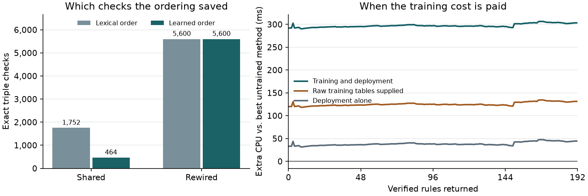

# Learning which three inputs to check first

On November 15, 2026, the frozen learner returned the exact minimum on all 96 shared rules and all 96 rewired rules. It used **258.822 ms** of process CPU for training and **335.941 ms** for deployment through verified return. The fastest untrained primitive method used **291.583 ms** for the same 192 programs. The learner's total was **594.763 ms**. No prefix broke even. The final cost gap was **303.180 ms**, and all ten paired CPU comparisons favored the primitive. [Numeric results](../../artifacts/TRIPLE-ORDER-20261115-001/TRIPLE-ORDER-20261115-001-E001_rank_triples/result.json)

## What was learned and what was verified

The learner gets two complete Boolean truth tables. When each input is flipped in turn, it measures how often the first answer, the second answer, or both change. A shared hidden bit can give the three inputs that feed it similar patterns of changes. Training chooses how to use this signal, which local patterns to favor, and when the cost of making a suggestion is worth paying. At deployment the policy can promote one triple. Every other eligible triple remains available to the exact search.

The return is a physical NAND program with two outputs. If a triple supports a one-bit summary, search can stop as soon as it finds that triple. On a two-bit rule, search must check every eligible triple for a possible one-bit answer. A priority can bring a good two-bit candidate forward and can reduce the number of residual columns inspected on later candidates. It cannot certify that every other triple needs at least two bits. The public-table verifier checks the minimum, every output value, and that every path from the three chosen raw inputs to either output actually passes through the reported intermediate wires. [Prespecified study](preregistration.md) · [Previous two-output test](../FOLD-TWO-OUTPUT-20261115-001/two_outputs.md)

Training used 24 matched pairs and 2,800 supervised candidate triples. The held stream contained 96 different pairs and 11,200 eligible triples. Each pair keeps the outside computations fixed. One consumer changes which local input plays which role. Seven-, eight- and nine-input tasks and two inner operations were balanced in each split. Every input matters to both outputs. Every task also includes an inferior triple that looks sufficient for a one-bit message if judged using only one output. The generator excludes training/held overlap under raw-input renaming or output exchange, and uses disjoint families of outside computations. These exclusions apply to the archived two-output panel too. There are 31 held rewires with several minimizing triples. Any of those triples earns full credit.

The fit compared 55 candidate policies and selected two relative input-flip patterns from its labelled examples. In the first pattern, each of the three inputs changes the answer equally often. In the second, one input changes it twice as often as either of the other two. Those ratios agree with the two local Boolean functions that generated the tasks. Direct enumeration gives flip counts of 2, 2, 2 for a multiplexer and 2, 2, 4 for `(a AND b) XOR c` over the four possible settings of the other two inputs. The model has no operation name or formula. It kept the joint-change statistic and selected a threshold of 35 eligible triples. All three tested arities have at least 35, so this panel cannot tell whether that threshold transfers to smaller problems. [Frozen policy](../../artifacts/TRIPLE-ORDER-20261115-001/TRIPLE-ORDER-20261115-001-E001_rank_triples/model.json) · [Fit and candidates](../../artifacts/TRIPLE-ORDER-20261115-001/TRIPLE-ORDER-20261115-001-E001_rank_triples/fit-diagnostics.json)

| Ordering on the same primitive engine | Exact checks on 96 shared rules | Shared rules found on first check | Exact checks on 96 rewires | Rewires with a minimum on first check |
| --- | ---: | ---: | ---: | ---: |
| Lexical, with public output cache | 1,752 | 45 | 5,600 | 41 |
| Fixed joint-change statistic | 747 | 75 | 5,600 | 66 |
| Fixed detailed transition statistic | 713 | 72 | 5,600 | 54 |
| Frozen learned ordering | 464 | 81 | 5,600 | 71 |
| Fixed four-cofactor ordering | 203 | 64 | 5,600 | 73 |

On shared rules, the frozen ordering saved 1,288 exact checks relative to lexical order. In 40 of those rules neither output truth column had appeared earlier in the stream. The first learned proposal succeeded on 29 of those 40, the fixed joint-change statistic succeeded on 25, and lexical order succeeded on zero. The learner's advantage over lexical search therefore extended to genuinely new columns. On rewired rules it reached a minimum sooner, which let it rule out some other candidates using fewer columns. The two methods inspected 19,475 and 20,949 packed residual columns respectively in those exact checks. Under this protocol even an ideal ordering would pay for 96 checks on the shared rules and 5,600 on the rewires. The four-cofactor control shows why first-choice accuracy alone is an incomplete measure. It found fewer shared solutions on its first check, but ordered the remaining candidates well when the first one failed. Its additional cofactor computations are charged to its CPU time.

## What was timed

The principal comparison starts before training and ends when all 192 held programs have been returned and verified. The trained policy and the four untrained variants of its primitive backend have equal access to shared NAND gates, on-demand caches and prior proposals for a recurring, identical output truth column. Two archived primitive solvers provide a comparison across implementations. No solver is told that two rules were generated as partners. Every deployment opens empty caches and sees the same sequence. A frozen policy always reloads the same weights.

The paid training clock covers generating candidate tasks, rejecting unsuitable tasks, computing supervisory labels, fitting all candidates, serializing the selected policy, and validating its reload. The deployment clock covers imports, loading model parameters, program and checker initialization, ranking, unsuccessful checks, both output programs, the physical and minimum-width checks, and serializing the final return. The additional independent scalar replay is a scientific check outside all seven clocks. The stream length and training budget were fixed before the policy was fit.

| Method | Deployment CPU (ms) | Common verification CPU (ms) | Total CPU including training (ms) | Total elapsed (ms) | Exact triple checks |
| --- | ---: | ---: | ---: | ---: | ---: |
| Archived shared primitive solver | 291.583 | 59.703 | 291.583 | 1,377.543 | 8,381 |
| Same backend, lexical order | 299.956 | 52.672 | 299.956 | 1,329.271 | 7,352 |
| Fixed four-cofactor order | 332.008 | 53.311 | 332.008 | 1,441.332 | 5,803 |
| Frozen learned order | 335.941 | 44.373 | 594.763 | 2,477.798 | 6,064 |
| Fixed joint-change statistic | 338.095 | 41.676 | 338.095 | 1,393.508 | 6,347 |
| Fixed detailed transition statistic | 342.817 | 43.181 | 342.817 | 1,519.297 | 6,313 |
| Independent primitive solver with exhaustive class enumeration | 362.070 | 59.366 | 362.070 | 1,603.203 | 11,200 |

The table reports medians over ten warm deployments with counterbalanced method order. The learner took 15.2% more deployment CPU than the fastest primitive even with all training waived. Against the matched lexical baseline, it spent another 35.985 ms in deployment. Median startup CPU was 62.524 ms for learned order versus 42.300 ms for lexical order. Median CPU after startup was 269.738 versus 255.781 ms. The learned method spent 14.574 ms preparing orders through their first proposal. Subsequent iterator work is included in the search clock. Durations for different phases have separate medians and need not sum to the whole-stream median. New methods retain candidate-level traces in the search loop; the matched lexical, feature and learned comparisons use the same instrumentation.



**Where training time went.** Generating the training cases and computing their labels cost 198.007 ms. Imports cost 46.907 ms, fitting cost 12.225 ms, and freezing and validating the model cost 1.619 ms. For a cheaper training-data scenario, a separate fresh process recovered the same 2,800 exact labels from already available truth tables for 26.092 ms. Giving the learner those raw tables and charging this cheaper label pass, fitting, setup and verification still left a 131.265 ms gap. Giving it all training labels left a 105.173 ms gap. Giving it the entire frozen policy left a 44.358 ms gap. None of these cumulative median cost curves reached break-even on this stream. [Official training ledger](../../artifacts/TRIPLE-ORDER-20261115-001/TRIPLE-ORDER-20261115-001-E001_rank_triples/train-receipt.json) · [Raw-table labelling measurement](../../artifacts/TRIPLE-ORDER-20261115-001/TRIPLE-ORDER-20261115-001-E001_rank_triples/label-cost.json)

These measurements support transfer of a learned search priority to unseen consumer structures in these two operation families. The exact criterion and physical synthesis were supplied. Feature computation and certification cost real CPU, especially when every candidate has to be excluded as a one-bit solution. The experiment stopped after the prespecified 192 rules.

## Reproduction

The 70 streams ran in isolated processes on one pinned logical CPU of an Intel Core i7-13700KF with Python 3.13.3. The first measured stream completed about ten seconds after source binding. The largest recorded worker used 27.1 MiB. Each complete stream checks 57,344 original assignments and both output values. All 13,440 returned circuits passed, covering 4,014,080 assignments and 8,028,160 output bits counting repeated runs. The model and sources are bound by their hashes, and the official model freeze precedes held-data release. [Bound sources](../../artifacts/TRIPLE-ORDER-20261115-001/TRIPLE-ORDER-20261115-001-E001_rank_triples/design.json) · [Held-stream receipt](../../artifacts/TRIPLE-ORDER-20261115-001/TRIPLE-ORDER-20261115-001-E001_rank_triples/held-bound.json) · [Per-worker receipts](../../artifacts/TRIPLE-ORDER-20261115-001/TRIPLE-ORDER-20261115-001-E001_rank_triples/results.jsonl)

The independent audit reproduced all 55 fitting scores, both learned shape preferences, each recorded candidate check and the cost arithmetic. Its scalar evaluator executed all 399 distinct physical task/program/cut combinations, using 6,903,040 NAND evaluations on 120,960 rows. The other returns matched one of those combinations exactly. This covers every saved program and its physical cut, including repeated runs. [Independent audit](../../artifacts/TRIPLE-ORDER-20261115-001/TRIPLE-ORDER-20261115-001-E001_rank_triples/audit.json) · [Replay code](audit.py)

To rebuild the numerical report from the retained receipts, run `python3 -B research/TRIPLE-ORDER-20261115-001/assess.py`. For a new timed run, point `out` at a fresh directory and execute the commands below from the repository root.

```bash
exp=experiments/TRIPLE-ORDER-20261115-001/TRIPLE-ORDER-20261115-001-E001_rank_triples
python3 -B "$exp/prepare.py" bind --out "$out"
python3 -B "$exp/prepare.py" train --out "$out"
python3 -B "$exp/prepare.py" label --out "$out"
python3 -B "$exp/prepare.py" release --out "$out"
python3 -B scripts/longrun.py launch "$exp/job.py" --out "$out" --unit triple-order-frozen --workers 1 --case-timeout 150 --case-mem 1G --mem-max 2G --max-cases-per-worker 1 --param "data_dir=$out" --prepare-only
python3 -B scripts/longrun.py run --out "$out" --foreground
python3 -B research/TRIPLE-ORDER-20261115-001/assess.py "$out"
```
