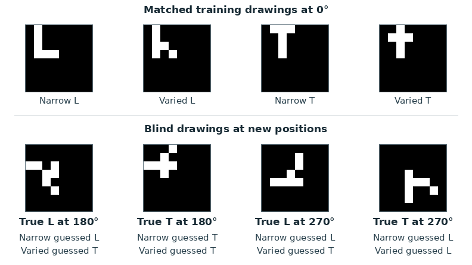
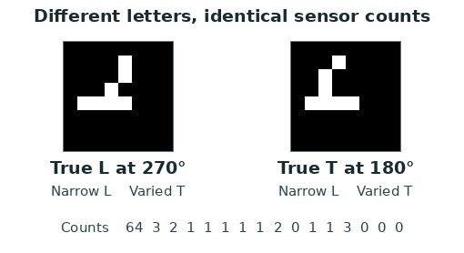

# Did varying the training drawings teach L and T at unseen turns?

**No.** Changing 48 of the 64 training drawings broke the old 240-way tie and taught the fixed learner to count a different group of pixel patterns. On the same 512 blind images at unseen rotations, the narrow arm got **304/512** and the varied arm got **256/512**, exactly the fair-guess expectation. Parity and not-all-equal gave the same decisions. One pair of differently labeled drawings also exposed a limit in the sensor itself.

| Scope | Verdict | Why |
| --- | --- | --- |
| This attempt · recognize both letters at unseen turns | **Status: Failed** | Varied passed 32/64 required cells, narrow 38/64 |
| Local direction · vary drawings with the count sensor fixed | Retire for this target | Different letters can give all 16 counts in common |
| Broader exploration · visual learning from raw pixels | Known alternative | Relative pixel arrangement can distinguish the observed pair |
| Long-term goal · G15 Learning in a knot pattern | Obstruction learned | Training changed the knot-held clue and its use |

## The same blind test for both arms

Counts below are correct/total for the true letter. Each entry applies separately to parity and not-all-equal. The panel held out eight designs across both training arms. The four turns and 16 positions gave 1,024 new bitmaps. Coordinates, class names and turn information were confined to the environment and scorer. Each arm received 32 L and 32 T, at 0° and 90° only. Narrow replayed the original 64 training inputs. Varied retained 16 straight examples and replaced 48 with matched bends in the stem, the bar, or both. Each replacement preserved class, amount of ink, bounding box, angle, location, presentation order and actual reward bit. Both training turns contained all 16 varied designs. [Frozen protocol](preregistration.md) · [Geometry and split](../../experiments/VARIED-LETTER-DRAWINGS-20261122-001/VARIED-LETTER-DRAWINGS-20261122-001-E001_drawings/panel/manifest.json)

| Clockwise turn | Positions | Narrow L | Narrow T | Varied L | Varied T |
| --- | --- | ---: | ---: | ---: | ---: |
| 0° | Familiar | 64/64 | 48/64 | 32/64 | 64/64 |
| 0° | New | 64/64 | 48/64 | 32/64 | 64/64 |
| 90° | Familiar | 16/64 | 48/64 | 16/64 | 56/64 |
| 90° | New | 16/64 | 48/64 | 16/64 | 56/64 |
| 180° | Familiar | 40/64 | 40/64 | 0/64 | 64/64 |
| 180° | New | 40/64 | 40/64 | 0/64 | 64/64 |
| 270° | Familiar | 32/64 | 40/64 | 16/64 | 48/64 |
| 270° | New | 32/64 | 40/64 | 16/64 | 48/64 |

At 180° the varied arm guessed T on all 256 images. At 270° it got 32/128 L and 96/128 T across both position conditions. Each arm's frozen gate required strictly above half separately for every reserved design, true letter, unseen turn and position condition. The sensor already shares counts across positions, so the eight placements within each cell all receive the same decision. At the level of distinct design–letter–turn cases, narrow got 19/32 and varied 16/32. Training variation gained four and lost seven, corresponding to **64 gains and 112 losses** on the 512 paired bitmaps. Both were right on 192 and both wrong on 144. Narrow also led on each reserved base family separately, 160 versus 144 of 256 for the wide forms and 144 versus 112 of 256 for the square forms. At the two training angles the totals on these reserved designs were 352/512 narrow and 336/512 varied. [All class cells, controls and paired counts](../../artifacts/VARIED-LETTER-DRAWINGS-20261122-001/VARIED-LETTER-DRAWINGS-20261122-001-E001_drawings/scored/scores.json)

## Which clues survived

All 32,767 eligible partitions of the 16 anonymous local categories faced the same separation score, then the same preference for a smaller group. Narrow reproduced all 240 groups having different class means and zero variation within each class, and retained its previous two singleton votes. In the varied arm **none** of the 240 still attained first place. No group perfectly separated the training classes with zero spread. For example, the old upper-right-only count was always 1 on narrow L. Two varied L receipts contained 2 and 3 such windows. Its rank fell to a score of 8/19. The other old singleton fell to 72/35. The older clue that counted every three-lit window now ranged from 1 to 3 on training L and from 2 to 4 on training T. [Complete group census and receipt witnesses](../../artifacts/VARIED-LETTER-DRAWINGS-20261122-001/VARIED-LETTER-DRAWINGS-20261122-001-E001_drawings/group_diagnostics.json)

Two groups tied for the highest varied score, 121/31. In row-major two-by-two notation the retained group is **`01/11` plus `11/01`**. Both pixels in the right column must be lit and exactly one in the left. Its training mean was 1/4 for L and 13/8 for T. With the fixed nearest-mean vote, zero occurrences say L, and one or more say T. That clue has a preferred orientation. The tied larger group adds `11/11`, a fully lit window. This window occurred zero times on all training and test images. The size preference retained the two-pattern group, and the larger group agreed with it on all 512 unseen-turn cases. Choosing the other tie would have produced the same answers. [Fitted memberships](../../artifacts/VARIED-LETTER-DRAWINGS-20261122-001/VARIED-LETTER-DRAWINGS-20261122-001-E001_drawings/fit/diagnostics.json) · [Votes and group order](../../artifacts/VARIED-LETTER-DRAWINGS-20261122-001/VARIED-LETTER-DRAWINGS-20261122-001-E001_drawings/blind/group_order.json)

## Where the visual distinction was lost

A 270° L and a 180° T at the same new position have different bitmaps and exactly the same **complete** count vector. Both contain seven lit pixels. The narrow reader calls both L and the varied reader calls both T. The pair has equal evidence for all 32,767 groups available to the learner.

This collision persists across all 16 placements of each drawing. Under the frozen balanced weighting a deterministic function of the full count vector must miss at least 16 of the 512 held images. Its exact ceiling is 496/512, and the requirement to pass every single design–letter–turn cell is unattainable on this panel. The opposite labels coincide across angles. Each held angle considered in isolation has no cross-label collisions in the **complete** sensor, but the learner receives no angle label. Keeping only each fitted arm's selected count or counts lowers its respective empirical ceiling to 336/512. The observed scores leave additional losses attributable to the chosen groups and fixed vote. [Inspectable collision](show_sensor_collision.py) · [Collision counts and ceilings](../../artifacts/VARIED-LETTER-DRAWINGS-20261122-001/VARIED-LETTER-DRAWINGS-20261122-001-E001_drawings/group_diagnostics.json)

## What changed in the knots

Each physical reader reused 40,494 ternary holdings. Its phase, receipts, class sizes and sums, and group flags lived there. Finalization erased the receipts. In each law a prepared mark and dock force the read under the full open relation. The archived checker reproduced both K1–K3 projections and the failing two-codeword preparation check byte for byte. Pixel scanning, position sharing, ranking, the write operation and the vote remained supplied. No rotated templates, known corner clue, shared rotated coefficients, or angle entered the learner. [Operational knot checks](../../artifacts/VARIED-LETTER-DRAWINGS-20261122-001/VARIED-LETTER-DRAWINGS-20261122-001-E001_drawings/knot_checks.json)

| Intervention on identical inputs | Observed under each law |
| --- | --- |
| Exchange full words between narrow and varied learners | All 1,024 guesses followed the donor |
| Exchange only the learned group flags | All 1,024 guesses followed the other arm, changing 288 |
| Exchange class calibration while retaining the group choices | Zero guesses changed |
| Exchange opposite-label words within either arm | Both directions followed the donor on 1,024/1,024. This reversed 704 narrow and 1,024 varied guesses |
| Clear, sham and restore | Clear always produced L. Shams and restores preserved every original guess |
| Ordinary integer implementation of the same rule | Matched every test guess in both arms and conventions |

The remaining 320 narrow guesses were tied votes, so both opposite-label fits emitted the default. All checkpoint words and hybrid reads were checked. These results isolate the change between arms to which patterns the physical reader selected on the tested images. The ordinary arithmetic accounts for the classification behavior under both knot laws. [Blind state interventions](../../artifacts/VARIED-LETTER-DRAWINGS-20261122-001/VARIED-LETTER-DRAWINGS-20261122-001-E001_drawings/blind/interventions.json) · [Single-image replay](replay_examples.py)

Astra Max reviewed the design before freeze. The independent replay checked all 768 training updates, 12 fitted states and 45,056 issued decisions. A clean producer run reproduced all 18 deterministic payloads. The first supplementary diagnostic invocation supplied all four turns to a routine requiring held turns. It rejected the input. The documented invocation passed exactly the 512 preregistered held cases to the same frozen diagnostic. The classifier, score release and primary decisions were already sealed. [Review](design_review/red_team_report.json) · [Execution audit](audit/R2/red_team_report.json) · [Referee handoff](referee_handoff.md)

**Next step:** Research directions — No next action selected.

| # | Direction | Payoff | Concreteness | First step → stop when | Status |
| --- | --- | --- | --- | --- | --- |
| 1 | Preserve enough pixel arrangement to distinguish the collided drawings | 2/3 | 3/3 | Check that the two arrangements remain distinct → require fresh blind transfer evidence | Alternative · deferred |

**STOP.** Additional training drawings cannot recover an image distinction already erased by this fixed sensor. A richer observation can be tested against the exhibited pair, but its transfer to new drawings is an open question.

**Corrections:** No earlier scientific claim changed. The rejected diagnostic invocation is recorded above.

**Goals:** G15 gained an exact sensing obstruction on the tested images and evidence that changed knot-held membership controlled the change in decisions.

**Assumptions:** A208 records the fixed stroke grammar, matched-slot intervention and finite weighting.

**Scaffolds:** A205 and A207 supply the shared local sensor, ranking, size preference, writes and vote. The stroke deformation and slot schedule are new. Scientific referee pending.
